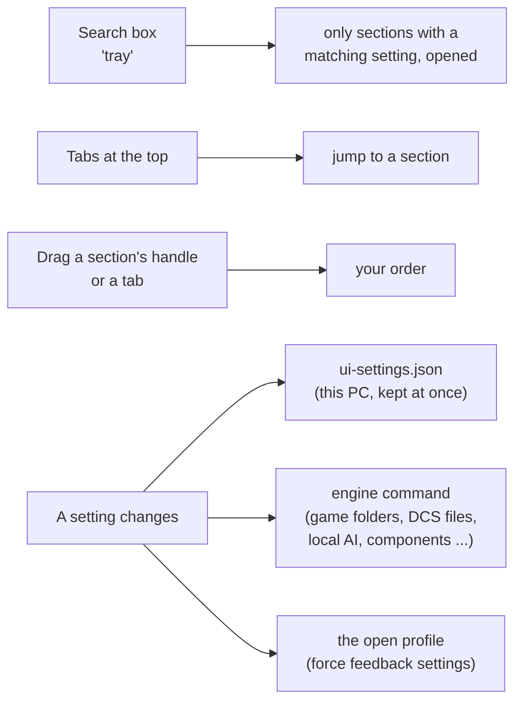

The Settings page holds every setting of JoyPro in 22 sections that open and close. A search box finds a setting by a
word ("tray", "update", "photos"), the tabs at the top jump to a section, and you can put the sections in your own
order. Every setting is kept at once and survives a restart; there is no Save button.

:::video settings-page "The Settings page"
:::

:::layer beginner
## How the page works

- **Open a section**: click its title. **Open all** / **Close all** at the top right open or close every section;
  the small arrow next to them puts JoyPro's order back with only **Games** open.
- **Find a setting**: type a word into **Search the settings**. Only the sections with a matching setting stay, and
  they open. The x clears the search.
- **Your order**: drag a section by its handle (or a tab at the top) to move it. JoyPro remembers which sections are
  open and their order.
- Settings take effect at once. A few say "at the next start" next to them.

The first start opens **Games** only; everything else is a click away. Most people only ever need **Games**,
**Appearance**, **Language** and **About JoyPro and updates**.

| Section | What you set there |
|---|---|
| Games | Which games you have, linked folders, the game config watcher, the vJoy device JoyPro uses |
| Binds | Follow input, recording of buttons that rest pressed |
| Startup | Open the last profile at start |
| Pages in the bottom bar | Hide pages, change their order |
| Language | JoyPro's language |
| Appearance | Light, dark or your own colours, text size, UI scale, theme editor |
| Run in the background | The tray helper that keeps watching your games |
| Confirmations | The questions JoyPro asks before a change |
| About JoyPro and updates | Version, project page, updates |
| Privacy | Makers' photos, picture packs, game covers |
| Usage statistics | The Statistics page, the ranking of your most used aircraft |
| Telemetry recording | Record your flights like Tacview |
| Drawings | How JoyPro draws your devices; reset your layout changes |
| Report a problem | One zip with everything needed to find a problem |
| Local AI | The optional language model |
| Components | vJoy, HidHide, ViGEmBus and other optional programs |
| Devices | Your devices, their names, replace or remove a device |
| Command lists (DB) and game paths | Expert information |
| DCS: default binds | DCS's own default binds in the DCS installation |
| Command lists of DCS, Star Citizen and IL-2 | Expert updates of the command lists |
| Force feedback settings of the games | The games' own force feedback options |
| DCS force feedback: swap and invert | DCS's force feedback direction per device |
:::

## The sections

### Games

One card per game JoyPro supports and you have, with its cover, "Installed" or "Not installed", where it is and where
it keeps its controls.

- **Run setup again** opens the [[page:gui/first-start.html|first-start window]] again: tick the games you have, link
  folders, set config locations. **Detect again** looks for the games once more (after you installed or moved one).
- **Watch game configs**: when you change controls JoyPro manages inside a game, JoyPro asks after the game closed
  whether to take the change into your profile ([[page:gui/overlays.html|the game watcher]]).
- **vJoy device JoyPro tunnels into**: None (default) treats every vJoy device as a normal device, for example one
  VoiceAttack drives. A number tells JoyPro that this vJoy device carries JoyPro's own output
  ([[page:gui/vjoy.html|Virtual Joystick]]): imports leave it out and exports never clear it.
- **War Thunder: read the full command list from the game's archives**: on (default), JoyPro unpacks the game's
  `gui.vromfs.bin` and `lang.vromfs.bin` read-only for every aircraft and helicopter action. Off: only JoyPro's own list of
  the War Thunder actions it knows.
- **Hell Let Loose: Vietnam: use the Oodle library of another installed game**: the game's files are compressed and it
  ships no library to read them. With your yes JoyPro uses the one another game on this PC has, where it is. Off:
  JoyPro's own list of the gamepad keys, which is all the Xbox pad mode needs. **Ask again** forgets your answer.
- Per card: **Choose folder...** / **Choose .exe...** link the game's folder (a portable install, another drive); **Use
  detected** forgets the link; **Hide** hides a game you do not have everywhere in JoyPro (your binds for it stay).
  Hidden games are listed at the end with **Show again**.

:::ingame Linked folders and hidden games
Nothing changes in a game here. A linked folder decides where import and export read and write; a hidden game gets no
export tile and is not watched.
:::

### Binds

- **Follow input on the Binds and Relations pages**: press a button (or move an axis a long way) and the page jumps to
  its relation; press it again for the next relation on it. Not while recording or typing.
- **Show the note over the list when follow input jumps** ("BTN 8 on WarBRD: Gear (1/3)"), off by default.
- **Record: also take a button that rests pressed when it is released**: a 3-way switch's middle position or a mode
  switch is pressed all the time; ticked, letting it go during recording counts as that button.

### Startup

**Open the last profile at start** (on by default) opens the profile you had open last; the path is shown below. The
note explains the profile history: every change is saved by itself and every save is a version in **History** (top
bar). Old versions are thinned out: all of the last day, then one per hour for 7 days, one per day for 60 days, one per
week after that; at most 200 MB per profile and 1 GB for all. Versions you keep stay.

### Pages in the bottom bar

One row per page of the bottom bar. Untick a page you do not use; drag a row by its handle (or use the arrows) to
change the order. A hidden page still opens from other pages (for example **Open the Modifiers page**) and shows in the
bar while it is open. Settings cannot be hidden. **Reset to default** brings JoyPro's order back with every page shown.

### Language

**Language of JoyPro**: English and 38 other languages, or **Windows language** (the display language of Windows, or
English when JoyPro does not have it). The translations are made by a machine and may sound odd; game command names
stay as the game names them. The tray helper's menu follows the language.

### Appearance

- **Colours**: **Light**, **Dark** or **System** (follows Windows), and your own themes with **Use** and **Edit**.
- **Text size** (Ctrl+Plus, Ctrl+Minus, Ctrl+0) and **UI scale** (the whole window: texts, buttons, pictures,
  spacing), both on top of Windows' display scaling; **Reset** next to each.
- **Theme editor: your own colours and fonts**: **New theme from Light** / **New theme from Dark** start a theme;
  **Import...** loads a theme file someone shared. Then name it, pick fonts, line spacing, heading size and every colour,
  with a live preview of a small JoyPro page and a contrast check ("Some texts are hard to read" with **Fix the
  contrast**). **Use this theme**, **Save**, **Duplicate**, **Export...**, **Reset colours** and **Delete** are below the
  colours.

### Run in the background (system tray)

JoyPro can only notice that you changed controls in a game while it runs. A tiny helper keeps watching as an icon in
the system tray after you closed JoyPro; it uses no noticeable CPU and a few MB of memory.

- **Start with Windows (in the tray)**: the helper starts when you sign in; JoyPro's window does not open. No
  administrator rights needed.
- **Close to tray**: closing JoyPro (X) leaves the helper watching. Off: closing JoyPro ends the watching too.
- Tray icon: click to open JoyPro (or to review a game's changes); right-click for "Watching game configs" on or off
  and "Exit".

### Confirmations

JoyPro asks before a change that is hard to take back. The questions you can switch off are listed here: removing an
action from a relation, an import that drops changes you did not export yet, the first export to a game the profile
never imported from, an export that removes binds, and the watcher hint in the import. A question you switched off
with "Do not ask again" shows here unticked; **Ask everything again** turns them all back on.

### About JoyPro and updates

The version, the build and the licence line, **Project page** and **Release page**, the third-party notices, and the
updates: **Check for updates**, **Install update** (downloads the new version, checks it, installs it and restarts
JoyPro), **Check for updates at start**, and **Offer it again** for a version you skipped. "Where updates come from
(for experts)" names the GitHub repository whose releases JoyPro installs.

### Privacy

JoyPro has no account and no telemetry. It goes online only for update checks, makers' product photos (after you said
yes), game covers missing on this PC, the optional AI model download, optional drivers and a missing .NET Framework.

- **Makers' product photos**: Ask for each device (default), Always download, Never (only JoyPro's drawings). **Ask
  again for every device** forgets your per-device answers.
- **Download reference photos automatically**: a device's reference photos are fetched in the background when it
  appears (from the original address, or the web archive), checked and kept in your data folder. Off: JoyPro offers
  them and waits for your click.
- **Pictures from JoyPro's releases (cockpits, 3D device views)**: Ask, Always download or Never. Used by the
  [[page:gui/cockpits.html|Cockpits]] page and the 3D device views of the Layout page.
- **Game covers from the internet**: covers Steam has no picture of on this PC are downloaded once. Takes effect at the
  next start.

### Usage statistics

JoyPro notes which games, aircraft and ships you use, from the games' own logs and Steam's playtime, and keeps a summary
on this PC.

- **Show the Statistics page in the bottom bar** (off by default): the [[page:gui/statistics.html|Statistics]] page.
- **Lay out new aircraft like my most used one**: Auto Assign, Auto Group, the Setup wizard and Lay out with AI give an
  aircraft you have not flown yet the layout of your most used aircraft of its class (jets, helicopters, spaceships).
- **Read the games' logs now** reads what your games logged since the last time.
- The ranking "Most used aircraft, ships and vehicles" and "Most used games": **Pin** makes an aircraft the model for
  its class; **Exclude** leaves it out of the ranking.

### Telemetry recording

Records every round, mission or flight with all the telemetry the game sends (position, attitude, speeds, controls,
engines, weapons, events), like Tacview does for DCS, for every game JoyPro reads telemetry of.

- **Record the telemetry of my games** (off by default), the **Folder** (**Choose...**, **Default folder**, **Open
  folder**), **Values per second**, **Space for recordings** (the oldest go first), **Delete recordings after**, and
  **Also keep the raw data as the game sent it** (about twice the size).
- **Games**: tick the games to record.
- **Recorded sessions**: date, game, aircraft, length and size, a small timeline of the selected one, **Show in
  folder**, **Export for Tacview (ACMI)**, **Export CSV** and **Delete**.

### Drawings

How JoyPro draws your devices on the Layout page and the device cards (lines or cel-shaded, JoyPro's colours or your
own), separately for the screen and for cheat sheets and exports. **Reset all my layout changes...** puts every
device's picture back to JoyPro's default (your marker positions, tables and lines, renamed parts, photos, own device
definitions and the layout files the profile uses; the files themselves stay); **Undo reset** right after brings them
back. One device alone: the Layout page, its **Model...** menu. The drawing controls are explained on
[[page:gui/layout.html|Layout]].

### Report a problem

1. Write what happened into **What happened?**
2. **Create Report**: JoyPro shows what goes in, then saves one zip with your text and what is needed to find the
   problem (JoyPro's logs of at least the last 14 days, errors and crash reports, settings and versions, your devices,
   per game its folders and JoyPro's backups; with **Include my open profile and its history** also your profile, its
   history and the games' current bind files) and shows it in Explorer. Your user name, e-mail addresses and passwords
   are removed.
3. Attach the zip to a GitHub issue (**Open GitHub Issue Page**) or send it to the developer. Nothing is sent by itself.

**Keep background logs for** n days (default 30; at most 200 MB together) and **Open Log Folder** are below.

### Local AI

Optional. JoyPro's offline rules always work; a free open-source language model can additionally read free sentences
in Manage with AI, Edit with AI, the JoyPro assistant and Group by description, and JoyPro checks every answer. It runs
on this PC only while you use it.

- **Use the local AI model**, its status (loaded, ready, off, problem), **Start now**, **Stop now**, **Stop after** n
  **idle minutes**, **Refresh**.
- **Download a model**: the model and runtime (auto, cpu, vulkan, cuda), its size and licences, **I accept the size and
  the licenses above**, **Download and switch on**, **Cancel download**, **Remove model**.
- **Already have llama.cpp and a GGUF model?**: the paths to `llama-server.exe` and the `.gguf` file, **Find on this
  PC**, **Use these files**, **Stop using them**.

### Components

- **Needed by JoyPro**: the .NET Framework and the engine's files, with **Check Again** and **Install Missing**.
- **Optional**: one card per free program that is not part of JoyPro: vJoy (virtual joystick), HidHide (hides real
  devices from games), ViGEmBus (virtual Xbox pad), BYOJoystick for VTOL VR, and the local AI model. Each card says
  what it is for, its state, **Project page**, **Windows apps** (repair or uninstall), its licence, the tick "I have
  read..." and **Install**. JoyPro downloads the official installer only after your tick, checks it and runs it;
  Windows asks once for administrator rights. Force feedback needs no extra program.

### Devices

**Look again** shows a card per connected stick, throttle and pedals and per device your profile uses: its picture
(click it to open the device on the Layout page), name, connected or not, and how many binds it has.

- **Device names**: show the alias you gave on the Layout page, or the device's real name.
- **Use its axes for follow input and recording**: for analog keyboards, whose keys also report as axes.
- **Replace...** gives a device's binds to another device, input by input, with a preview (a new stick, a profile from
  an old PC); **Move binds** there asks first and keeps a copy of the profile. **Remove** takes a sold device's binds
out of the profile; it asks first and keeps a copy of the profile too.
- "Device lists and names (for experts)": **List Devices**, **Input Catalog**, **Device Details**, and the old
  **Exchange Device** / **Remove Device Refs** by typed names.

### Command lists (DB) and game paths: information for experts

Read-only answers in the Output panel about what JoyPro knows of each game: **DB Summary**, **DB Check**, **DB List**,
**DB Games**, **DB Planes**, **DB Fingerprint**, **Game Paths**, **Games List**, **Games Detect**, with filters for a
game and an aircraft. To read a game's new commands after an update, use **Update** on the game's card on the Start
page.

### DCS: default binds

DCS puts its own default binds on every device. JoyPro's DCS export already removes them from every device it writes,
in every aircraft. The two options here change the DCS installation itself, for **all** devices; both are off unless
you switch them on.

- **Strip DCS default binds in the DCS install**: every joystick input file of DCS gets its default binds switched off;
  each original is kept as `<file>.nocombo.bak`. **Keep the UI layer's default binds (menus, VR)** leaves the UI layer
  as it is.
- **Remove DCS's device-specific default files from the install**: files such as "Joystick - HOTAS Warthog.lua" move
  into JoyPro's backup folder, so DCS uses its plain default for every device.
- **Preview files**, **Preview device files**, **Apply now** (again after a DCS update), **Restore DCS files**, **Check
  again**; the folders and **Find the folders**; under "Folders and older JoyPro backups": **Put back files an older
  JoyPro moved**.

:::warn
These options change DCS's own files. Some multiplayer servers do not let you in while they are on; **Restore DCS
files** puts DCS's files back. A DCS update or repair brings the original files back; JoyPro switches the option on
again at its next start.
:::

### Command lists of DCS, Star Citizen and IL-2 (for experts)

Normally a game's list is built with **Update** on its card on the Start page. Here: only some DCS aircraft, a test run
without writing, and the old click mode.

- **DCS**: pick aircraft (**All** / **None**), **Headless** (recommended: DCS stays closed and JoyPro uses DCS's own
  Lua), **Dry Run**, **Refresh ID DB**, **Refresh Clean DB**; without Headless the legacy click mode with **OCR**,
  **Launch**, **Keep Running** and **Preview Clicks**.
- **Star Citizen DB**: the game branch (LIVE, PTU, ...), **Dry Run**, **Refresh Star Citizen DB**.
- **IL-2 Great Battles DB**: **Dry Run**, **Refresh IL-2 DB**.

### Force feedback settings of the games

Every force feedback setting a game offers (strength, effects, per device and, in DCS, per aircraft). JoyPro stores the
values you set in the profile and writes them into the game on export; settings you do not store stay as the game has
them. Pick the **Game**, the **Device** and the **Aircraft** (All aircraft, or one aircraft whose values win), change
values, then **Apply**. **Revert** drops unapplied changes, **Unset** on a row stops storing one setting, **Clear**
removes every stored setting shown. The telemetry force feedback of JoyPro itself is on the
[[page:gui/ffb.html|Force Feedback]] page.

### DCS force feedback: swap and invert per device

If your force feedback stick pushes the wrong way in DCS: tick **Swap Axis**, **Invert X** or **Invert Y** for it,
then **Apply**. **Clear** gives the device DCS's defaults back. A table of devices with filters (**Connected only**,
**Profile only**), selection buttons and **Apply Selected** / **Clear Selected** / **Clear All**; "Manual single-device
(advanced)" sets one device by name.

:::ingame Swap and invert
DCS reads the force feedback direction per device at start: a swapped or inverted device pushes the other way in every
aircraft.
:::

:::layer advanced
## Tips and interactions

- **Games** and the **first-start window** are two views of the same data: a link set in one shows in the other.
- A game hidden in **Games** disappears from the Start page, the Export tiles, the watcher, the game backups and every
  game list; its relations stay in the profile and come back with **Show again**.
- **Watch game configs** and the **tray** options work together: with **Close to tray** the helper keeps watching after
  JoyPro closed and opens JoyPro on the game's changes.
- The **vJoy tunnel** device should match the device chosen on the [[page:gui/vjoy.html|Virtual Joystick]] page; then
  imports never pick up JoyPro's own output as binds and **Also clear my other devices** never empties it.
- **Report a problem** replaces copying logs by hand: the zip has the session log of the
  [[page:gui/output.html|Output]] panel, the engine's logs and, when you allow it, the profile and its history.
- **Confirmations** that matter most for safety are the export ones; switching them off makes Replace and nuke exports
  run without a question (the game files are still backed up; **Undo last export** on the Export page restores them).
- The **Local AI** status is the same line every AI action of JoyPro shows (the chip "Local AI: off - Turn on" next to
  Manage with AI, the assistant, Fix with AI on the Check).
- **Force feedback settings of the games** and **DCS force feedback** both end up in DCS: invert and swap fall back to
  the per-device values of the DCS table when no game setting stores them.
:::

:::layer technical
## Where the settings live

- PC settings: `%APPDATA%\JoyPro2\ui-settings.json` (window, pages, open sections and their order, theme, language,
  confirmations, privacy answers, tray, local AI choices ...), written at once on every change; themes as JSON files next
  to it. View model: `MainWindowViewModel.SettingsPage.cs` (sections, search, order; `SettingsSectionDefaults` holds the
  ids, titles and search keywords), controls `Views/Controls/SettingsSection.cs`, `SettingsSectionsPanel.cs`,
  `SettingsTabStrip.cs`.
- Game installs and config links: the engine's own settings, through [[cli:games installs]], [[cli:games install set]],
  [[cli:games install disable]], [[cli:games config set]] (`MainWindowViewModel.GameInstalls.cs`, `GameSetup.cs`).
- Pages: `MainWindowViewModel.NavPages.cs`; appearance: `MainWindowViewModel.Appearance.cs`, `Services/ThemeService.cs`;
  language: `MainWindowViewModel.Language.cs` ([[doc:localization|Localization]]).
- Updates: `MainWindowViewModel.Updates.cs` ([[doc:updates|Updates]]); report: `MainWindowViewModel.AppServices.cs`,
  [[cli:support bundle]] ([[doc:logging|Logging]]).
- Usage: [[cli:usage harvest]], [[cli:usage ranking]], [[cli:usage pin]] ([[doc:usage-statistics|Usage statistics]]);
  telemetry recording: `MainWindowViewModel.TelemetryRecording.cs`, [[cli:telemetry sessions]],
  [[cli:telemetry export]] ([[doc:telemetry-recording|Telemetry recording]]).
- Local AI: [[cli:llm status]], [[cli:llm download]], [[cli:llm use-local]], [[cli:llm start]]
  ([[doc:natural-language-grouping|Natural-language grouping]]); components: `MainWindowViewModel.Components.cs`
  ([[doc:components|Components]]).
- Devices: [[cli:devices list]], [[cli:devices inputs]], [[cli:devices exchange]], [[cli:devices remove]],
  [[cli:games devices]] ([[doc:devices|Devices]]).
- DCS defaults: [[cli:dcs strip-defaults]], [[cli:dcs device-luas]], [[cli:dcs defaults restore]]
  (`MainWindowViewModel.DcsDefaults.cs`); command lists: [[cli:dcs refresh id]], [[cli:dcs refresh clean]],
  [[cli:db refresh-starcitizen]], [[cli:db refresh-il2]]; the expert DB answers: [[cli:db summary]], [[cli:db check]],
  [[cli:db list]], [[cli:db games]], [[cli:db planes]], [[cli:db fingerprint]], [[cli:games paths]],
  `engine games list`, `engine games detect`.
- Force feedback of the games: [[cli:ffb models]], [[cli:ffb show]], [[cli:ffb set]], [[cli:ffb clear]] (stored in the
  profile, written on export; `MainWindowViewModel.FfbSettings.cs`); DCS swap/invert: [[cli:dcs ffb list]],
  [[cli:dcs ffb set]], [[cli:dcs ffb clear]].
:::

<!-- entry: ExpandAllSettingsCommand -->
Opens every section of the Settings page. Which sections are open is remembered for the next start.

<!-- entry: CollapseAllSettingsCommand -->
Closes every section, so the page shows only their titles; open the one you need by clicking it.

<!-- entry: NewThemeFromLightCommand -->
Theme editor: starts a new theme ("My light theme") from JoyPro's light colours and opens it in the editor with a live
preview. It is saved as a file only with **Save** or **Use this theme**.

<!-- entry: NewThemeFromDarkCommand -->
Theme editor: starts a new theme ("My dark theme") from JoyPro's dark colours and opens it in the editor.

<!-- entry: label:Open profile... -->
Part of the theme editor's live preview: a sample button that shows how buttons look in the edited theme. It does
nothing.

<!-- entry: label:Save -->
Part of the theme editor's live preview: a sample accent button. It does nothing.

<!-- entry: label:Delete -->
Part of the theme editor's live preview: a sample disabled button. It does nothing.

<!-- entry: label:Start -->
Part of the theme editor's live preview: a sample page button of the bottom bar. It does nothing.

<!-- entry: label:Relations -->
Part of the theme editor's live preview: the sample page button shown as selected. It does nothing.

<!-- entry: label:Binds -->
Part of the theme editor's live preview: a sample page button of the bottom bar. It does nothing.

<!-- entry: SaveEditingThemeCommand -->
Saves the edited theme as a file in JoyPro's settings folder (a name another theme has gets a number). When it is the
theme in use, the window shows the change at once.

<!-- entry: DuplicateEditingThemeCommand -->
Makes a copy of the edited theme ("<name> copy") and opens the copy in the editor, for a variant of a theme you like.

<!-- entry: DeleteEditingThemeCommand -->
Deletes the edited theme's file (asks first; **Export...** it before to keep a copy). When it was the theme in use,
JoyPro goes back to a built-in theme.

<!-- entry: RefreshGameInstallsCommand -->
Looks for your games again (Steam, launchers, the Windows apps list, your links), for example after you installed or
moved a game, and updates the cards here, the Start page and the Export tiles. Engine: [[cli:games installs]].

<!-- entry: AskHllvOodleAgainCommand -->
Forgets your answer about Hell Let Loose: Vietnam's files; JoyPro asks again the next time it builds that game's
command list.

<!-- entry: bind:IsVisible -->
Shows (ticked) or hides (unticked) this page in the bottom bar. A hidden page still opens from other pages and shows
while it is open. Settings cannot be hidden.

<!-- entry: ClearSkippedUpdateCommand -->
You chose "Skip this version" in an update offer: this forgets that, so the next check offers the version again.

<!-- entry: ReadUsageNowCommand -->
Reads what your games logged since the last time (logs, journals, logbooks, replays, Steam's playtime) and updates the
ranking and the Statistics page. Normally this happens at start and after a game closed. Engine:
[[cli:usage harvest]], then [[cli:usage ranking]].

<!-- entry: ToggleUsagePinCommand -->
**Pin** / **Unpin** on a row of the ranking: a pinned aircraft is the model for new aircraft of its class (jets,
helicopters, spaceships) when Auto Assign, Auto Group, the Setup wizard or Lay out with AI lay one out. Engine:
[[cli:usage pin]] / `unpin`. In the game: aircraft laid out after that get the pinned aircraft's button layout.

<!-- entry: ToggleUsageExcludeCommand -->
**Exclude** / **Include** on a row: an excluded aircraft or game no longer counts in the ranking (for example one you
only tried). Engine: `engine usage exclude` / `include`.

<!-- entry: ResetAllLayoutChangesCommand -->
Puts every device's picture back to JoyPro's default: your marker positions, tables and lines, renamed parts, photos,
own device definitions and the layout files the profile uses (the files themselves stay). Asks first; **Undo reset**
right after brings everything back. Engine: [[cli:layout image]] `--clear`.

<!-- entry: UndoLayoutResetCommand -->
"Undo reset": puts back the layout changes the last reset took away (marker positions, tables, photos, layout files of
the devices). Shown only right after a reset.

<!-- entry: ShowProblemReportCommand -->
Shows the zip **Create Report** made, selected in Explorer, to attach it or look into it first.

<!-- entry: OpenProblemIssuePageCommand -->
Opens a new issue on JoyPro's GitHub page in your browser with your description filled in; drag the report zip into the issue's text box there.
Nothing is uploaded by JoyPro.

<!-- entry: OpenLogFolderCommand -->
Opens JoyPro's log folder in Explorer: the background logs of the GUI and the engine and the session log of the Output
panel.

<!-- entry: bind:LlmEnabled -->
Switches the optional local AI model on or off for every AI action (Manage with AI, Edit with AI, the JoyPro assistant,
Group by description, Fix with AI). Off: JoyPro's offline rules only, which always work. The model loads at the first
request and stops after the idle minutes. Engine: `engine llm enable` / `disable`.

<!-- entry: RefreshLlmStatusCommand -->
Asks the engine again what is set up and running (model, runtime, loaded or not) and updates the status lines. Engine:
[[cli:llm status]].

<!-- entry: bind:LlmLicenseAccepted -->
Your yes to the download size and the licences shown above for the chosen model and llama.cpp. **Download and switch
on** works only with this ticked.

<!-- entry: CancelLlmDownloadCommand -->
Stops a running model download. The part already downloaded is kept; **Download and switch on** resumes it.

<!-- entry: RemoveLlmModelCommand -->
Deletes the chosen downloaded model from this PC to free the space. Engine: [[cli:llm remove]].

<!-- entry: click:BrowseLlmServerClicked -->
Picks your own `llama-server.exe` (from a llama.cpp you already have). Then press **Use these files**.

<!-- entry: click:BrowseLlmModelClicked -->
Picks your own `.gguf` model file. Then press **Use these files**.

<!-- entry: ClearLocalLlmCommand -->
Stops using your own llama.cpp and GGUF file; the local AI uses the downloaded model again (or is off when there is
none). Your files stay where they are. Engine: [[cli:llm use-local]] `--clear`.

<!-- entry: InstallMissingRequirementsCommand -->
Installs what JoyPro itself needs and lacks (for example the .NET Framework the engine needs) from the official
source, then checks again whether the engine starts.

<!-- entry: OpenDeviceCardInLayoutCommand -->
The picture of a device card: opens the device on the Layout page with its picture, markers and binds. Engine:
[[cli:layout suggest]].

<!-- entry: RefreshDevicesCommand -->
Fills the lists **Connected Devices** and **Profile Devices** below with the device names as the engine sees them.
Engine: [[cli:devices list]] `--connected --profile-devices`.

<!-- entry: RefreshDeviceInputCatalogCommand -->
Fills **Input Catalog** with every input name JoyPro knows (JOY_BTN1, JOY_X, keyboard keys ...). Engine:
[[cli:devices inputs]].

<!-- entry: ExchangeDeviceCommand -->
Moves every bind and modifier of the device typed in **Exchange Old** to the one in **Exchange New**, input names
unchanged (asks first and keeps a copy of the profile). For a guided move with a preview use **Replace device...**.
Engine: [[cli:devices exchange]]. In the game: after the next export the binds are on the new device.

<!-- entry: RemoveDeviceFromProfileCommand -->
Removes every bind and modifier of the device typed in the box from the profile; the relations stay (asks first and
keeps a copy). Engine: [[cli:devices remove]]. In the game: after the next export the device has no binds from
JoyPro.

<!-- entry: RefreshDbSummaryCommand -->
Compares each DCS aircraft command list with its DCS clean profile and shows the counts in the Output panel: aircraft
lists, missing clean profiles, names matched only by alias. Other games are not checked. Read-only. Engine:
[[cli:db summary]].

<!-- entry: RefreshDbCheckCommand -->
The same comparison as **DB Summary** (each DCS aircraft command list with its clean profiles), plus the list of DCS
aircraft without a clean profile in the Output panel; it reports a failure when one is missing. Read-only. Engine:
[[cli:db check]].

<!-- entry: RefreshDbListCommand -->
Lists the command list entries matching **Plane Filter** in the Output panel. Read-only. Engine: [[cli:db list]].

<!-- entry: RefreshDbGamesCommand -->
Lists the games JoyPro has command lists for (filtered by **Game Filter**) into **DB Games**. Read-only. Engine:
[[cli:db games]].

<!-- entry: RefreshDbPlanesCommand -->
Lists the aircraft of the game in **Planes Game** (filtered by **Plane Filter**) into **DB Planes**. Read-only.
Engine: [[cli:db planes]].

<!-- entry: RefreshDbFingerprintCommand -->
Shows a fingerprint of the command lists in the Output panel, to compare two PCs or two versions. Read-only. Engine:
[[cli:db fingerprint]].

<!-- entry: RefreshGamePathsCommand -->
Shows in the Output panel where JoyPro found each game and its config folders. Read-only. Engine:
[[cli:games paths]].

<!-- entry: RefreshGamesListCommand -->
Lists every game JoyPro supports (or the one in **Game Filter**) in the Output panel. Read-only. Engine:
`engine games list`.

<!-- entry: DetectGamesCommand -->
Runs the game detection and shows what it found and how, in the Output panel. Read-only. Engine:
`engine games detect`.

<!-- entry: AutoDetectSettingsPathsCommand -->
Fills the DCS Saved Games and install folders (and the Star Citizen paths) that are empty or wrong with the folders
JoyPro finds on this PC. Folders you set that exist are kept.

<!-- entry: PreviewDcsDeviceFilesCommand -->
Lists the device-specific default files of the DCS installation that **Remove DCS's device-specific default files**
would move into JoyPro's backup folder. Nothing is written. Engine: [[cli:dcs device-luas]] `list`.

<!-- entry: RestoreDcsInstallDefaultsCommand -->
Puts DCS's original input files back (from the `.nocombo.bak` copies) and the device default files JoyPro moved, and
stops switching them off after DCS updates. Asks first; close DCS before. Engine: [[cli:dcs strip-defaults]]
`restore`, [[cli:dcs device-luas]] `restore`. In the game: DCS's own default binds are back for devices JoyPro does not
write.

<!-- entry: RefreshDcsDefaultsStatusCommand -->
Looks at the DCS installation again and updates the status line (how many input files are without default binds, how
many device files are moved). Read-only. Engine: [[cli:dcs strip-defaults]] `status`.

<!-- entry: bind:DcsRefreshSelectAllPlanes -->
Ticks every DCS aircraft in the list below for **Refresh ID DB** / **Refresh Clean DB**.

<!-- entry: bind:DcsRefreshSelectNonePlanes -->
Unticks every DCS aircraft in the list. With none ticked, a refresh covers every installed aircraft.

<!-- entry: bind:IsSelected -->
One DCS aircraft of the list: ticked aircraft are the only ones **Refresh ID DB** and **Refresh Clean DB** read
(`--plane`).

<!-- entry: bind:DcsRefreshHeadlessLua -->
On (recommended): DCS stays closed; JoyPro reads the command lists with DCS's own Lua from your installation. Off: the
legacy click mode, which starts DCS and clicks through its controls menu. Engine: `--headless-lua`.

<!-- entry: bind:DcsRefreshDryRun -->
The refresh reads and reports but writes no command list. Engine: `--dry-run`.

<!-- entry: bind:DcsRefreshUseOcr -->
Legacy click mode only: reads the controls menu's text from the screen (OCR) to find the entries. Engine: `--ocr`.

<!-- entry: bind:DcsRefreshLaunch -->
Legacy click mode only: JoyPro starts DCS itself for the clicks (on by default). Engine: `--launch`.

<!-- entry: bind:DcsRefreshKeepRunning -->
Legacy click mode only: DCS stays open after the clicks. Engine: `--keep-running`.

<!-- entry: DcsRefreshIdCommand -->
Rebuilds the DCS command list with every action's id and name for the ticked aircraft (all when none is ticked), from
your DCS installation. Engine: [[cli:dcs refresh id]]. Normally **Update** on the DCS card of the Start page does this.

<!-- entry: DcsRefreshCleanCommand -->
Rebuilds the DCS "clean" list: the default binds DCS puts on devices, which the export removes from the devices it
writes. Engine: [[cli:dcs refresh clean]]. In the game: the next export removes exactly the defaults of the current
DCS version.

<!-- entry: DcsPreviewClicksCommand -->
Legacy click mode only: shows where the clicks would go in the controls menu (a picture with the click map), without
clicking. Engine: [[cli:dcs refresh preview-clicks]].

<!-- entry: RefreshStarCitizenDbCommand -->
Rebuilds the Star Citizen action list from the installed game (Data.p4k) or the source path set on the Export page:
actions, option groups, the joystick option tree and the game's default joystick binds. With **Dry Run** it only
reports. Engine: [[cli:db refresh-starcitizen]].

<!-- entry: RefreshIl2DbCommand -->
Adds the actions of IL-2's key mapping files (`data\input\*.actions`, or the IL-2 export path) that JoyPro's IL-2 list
lacks; known actions keep their titles. With **Dry Run** it only reports. Engine: [[cli:db refresh-il2]].

<!-- entry: bind:IsOn -->
An on/off force feedback setting of the game (for example an effect). Ticking it marks it changed; **Apply** stores it
in the profile and the export writes it into the game.

<!-- entry: RevertFfbEditsCommand -->
Drops the force feedback changes you made but did not apply yet; the rows show the stored or game values again.

<!-- entry: bind:DcsFfbShowConnectedOnly -->
Shows only the devices that are connected now in the DCS force feedback table.

<!-- entry: bind:DcsFfbShowProfileOnly -->
Shows only the devices your profile uses in the table.

<!-- entry: bind:DcsFfbAutoApplyOnToggle -->
When on, ticking Swap Axis, Invert X or Invert Y in the table stores that device in your profile at once, without
pressing **Apply** (DCS gets it at the next DCS export).

<!-- entry: DcsFfbListCommand -->
Reads the DCS force feedback settings of every known device again and fills the table. Engine: [[cli:dcs ffb list]].

<!-- entry: SelectAllDcsFfbDevicesCommand -->
Ticks **Sel** on every device of the table (for **Apply Selected** / **Clear Selected**).

<!-- entry: ClearDcsFfbDeviceSelectionCommand -->
Unticks **Sel** on every device of the table.

<!-- entry: SelectConnectedDcsFfbDevicesCommand -->
Ticks **Sel** on the connected devices only.

<!-- entry: SelectProfileDcsFfbDevicesCommand -->
Ticks **Sel** on the devices your profile uses only.

<!-- entry: DcsFfbApplySelectedCommand -->
Stores Swap Axis, Invert X and Invert Y of every selected device in your profile; DCS gets them at the next DCS export.
Engine: [[cli:dcs ffb set]]. In the game: those devices push the other way after the next export and DCS start.

<!-- entry: DcsFfbClearSelectedCommand -->
Removes the stored force feedback settings of the selected devices from your profile: from the next DCS export DCS
uses its defaults for them again. Engine: [[cli:dcs ffb clear]].

<!-- entry: DcsFfbClearAllCommand -->
Removes the stored force feedback settings of every device from your profile: DCS's defaults everywhere from the next
DCS export. Engine: [[cli:dcs ffb clear]] `--all`.

<!-- entry: DcsFfbApplyDeviceCommand -->
**Apply** on a row: stores that device's Swap Axis, Invert X and Invert Y in your profile; DCS gets them at the next DCS
export. Engine: [[cli:dcs ffb set]]. In the game: after the next export and DCS start.

<!-- entry: DcsFfbClearDeviceCommand -->
**Clear** on a row: removes that device's stored settings from your profile, so the next DCS export gives it DCS's
default force feedback direction back. Engine: [[cli:dcs ffb clear]].

<!-- entry: bind:DcsFfbInvertX -->
Manual single device: invert the force feedback on the X axis (left/right) of the device named above.

<!-- entry: bind:DcsFfbInvertY -->
Manual single device: invert the force feedback on the Y axis (forward/back).

<!-- entry: bind:DcsFfbSwapAxis -->
Manual single device: swap the X and Y force feedback axes (for a base mounted turned by 90 degrees or a stick that
reports them the other way round).

<!-- entry: DcsFfbSetCommand -->
Manual single device: stores the three ticks in your profile for the device named above (or for the selected rows of
the table, when any is selected); DCS gets them at the next DCS export. Engine: [[cli:dcs ffb set]].

<!-- entry: DcsFfbClearCommand -->
Manual single device: removes the stored settings of the device named above from your profile (the selected rows when
any; every device when the name is empty); the next DCS export applies it. Engine: [[cli:dcs ffb clear]].

<!-- entry: OpenLicenseCommand -->
On a component card: opens the component's licence on its official project page in your browser.

<!-- entry: bind:Consent -->
On a component card: "I have read ..." - your yes to download and install this program (its size, source and licence
are on the card). **Install** works only with this ticked.

<!-- entry: bind:AskBeforeFirstExport -->
On: the first export of a game this profile never imported from asks "Import first?", so the game's own binds are not
lost by surprise. Off: it exports at once.

<!-- entry: bind:AskBeforeExportRemoves -->
On: an export that removes binds (**Replace on my devices**, **Also clear my other devices**) asks once before it
writes. Off: it writes at once (the game files are still backed up; **Undo last export** restores them).

<!-- entry: bind:ShowWatcherHintInImport -->
On: the import shows the hint that JoyPro can watch the game for control changes you make in the game. Off: the hint
is hidden.

<!-- entry: OpenTelemetryFolderCommand -->
Opens the recordings folder in Explorer (**Show in folder**: with the selected recording selected).

<!-- entry: bind:Enabled -->
One game of the telemetry recording: ticked games are recorded while they run and send telemetry (when **Record the
telemetry of my games** is on). The line below says what JoyPro listens to for that game.

<!-- entry: RefreshTelemetrySessionsCommand -->
Reads the list of recorded sessions from the recordings folder again (newest first).

<!-- entry: DeleteTelemetrySessionCommand -->
Deletes the selected recording (asks first; the file is deleted, not moved to the recycle bin).

<!-- entry: OpenProjectCommand -->
On a component card: opens the component's official release page in your browser, where its own project describes it
and offers its downloads.

<!-- entry: OpenAppsSettingsCommand -->
On a component card that is installed: opens Windows' **Installed apps** list. Repair or uninstall the component there
with its own uninstaller; JoyPro does not remove components itself.

<!-- entry: InstallCommand -->
On a component card: **Install** with the component's name (**Update to** a version when an older one is installed).
Works only after the tick "I have read ...". JoyPro downloads the official installer, checks its SHA-256 checksum and
digital signature, then runs it; Windows asks once for administrator rights. One component installs at a time; a
driver may need a restart of Windows afterwards, which the card then says.

<!-- entry: CancelCommand -->
Shown while a component downloads: stops the download. An installer that already runs is not stopped by JoyPro; use
**Cancel** in its own window.

<!-- entry: bind:AskBeforeRemovingAction -->
On (default): the x of an action on the Relations page asks "Remove this action?" first. Off: the action is removed at
once; Ctrl+Z still takes it back. "Do not ask again" in that question unticks this box. Saved in JoyPro's settings.

<!-- entry: bind:AskBeforeImportDropsChanges -->
On (default): **Import** on a game card asks first when your profile has changes for that game that are not in the
game yet, with **Export first**, **Import** and **Cancel**. Off: it imports at once; the profile History still has the
version from before. Saved in JoyPro's settings.

<!-- entry: AskAllConfirmationsAgainCommand -->
Ticks every question of this section again, so JoyPro asks each one again from now on. Only enabled while at least
one question is switched off.

<!-- entry: TurnOnLocalAiCommand -->
On the "Local AI" chip next to AI actions, shown when a model is set up but switched off: switches the local AI on
with that model in one click ([[cli:llm enable]]); it loads with your next request. Without a model it opens
Settings > Local AI instead.

<!-- entry: OpenLocalAiSettingsCommand -->
**Set up the local AI** (and **Settings**) on the "Local AI" chip: opens Settings > Local AI and scrolls to it, where
you download a model (size and licence first) or point JoyPro to your own llama.cpp. Changes nothing by itself.

<!-- entry: StopLlmServerCommand -->
**Stop now**, shown while the local AI model is loaded: ends the model at once and frees its memory. The local AI
stays switched on; the next AI request loads the model again.

<!-- entry: bind:TelemetryRecordingEnabled -->
Off by default. On: while a ticked game runs and sends telemetry, JoyPro writes one recording per round, mission or
flight into the folder below. Off: nothing is recorded and JoyPro does not look for running games. Saved in the
telemetry recording settings; everything stays on this PC.

<!-- entry: click:ChooseFolderClicked -->
**Folder** > **Choose...**: picks where new recordings go, on any drive (an hour takes about 10 to 50 MB). The list of
**Recorded sessions** then shows the recordings of that folder; existing recordings are not moved.

<!-- entry: UseDefaultTelemetryFolderCommand -->
Shown when you chose your own folder: new recordings go to JoyPro's data folder again, and the list shows the
recordings there. Recordings in your folder stay where they are.

<!-- entry: bind:TelemetryRecordingKeepRaw -->
On by default: each recording also keeps the game's own packets, answers and files next to the values, for tools that
read them. A recording is then about twice the size. Off: only the values and events.

<!-- entry: ExportTelemetryAcmiCommand -->
Writes the selected recording as a `.zip.acmi` file that Tacview opens (track, attitude, speeds and the other objects
the game reported) into the `Exports` folder next to the recordings, and shows it in Explorer. Only for games whose
telemetry has a position. The recording itself stays as it is.

<!-- entry: ExportTelemetryCsvCommand -->
Writes the selected recording as a folder of CSV files (comma separated, decimal point) into the `Exports` folder next
to the recordings: one table of every value per moment, the events, the channel list and one small file per channel.
Explorer opens the folder.

<!-- entry: ClearSettingsSearchCommand -->
The x in **Search the settings**: clears the search, so every section shows again.

<!-- entry: ResetSettingsLayoutCommand -->
The small arrow next to **Open all** / **Close all**: puts the sections back in JoyPro's order with only **Games**
open. The new order is kept for the next start.

<!-- entry: SetThemeLightCommand -->
Shows JoyPro in its light colours at once. Kept for the next start.

<!-- entry: SetThemeDarkCommand -->
Shows JoyPro in its dark colours at once. Kept for the next start.

<!-- entry: SetThemeSystemCommand -->
JoyPro follows the Windows setting for apps (light or dark). Kept for the next start.

<!-- entry: UseCustomThemeCommand -->
**Use** on one of your own themes: shows JoyPro in that theme at once. Kept for the next start.

<!-- entry: EditCustomThemeCommand -->
**Edit** on one of your own themes: opens a copy of it in the theme editor below. Nothing changes until you press
**Save** or **Use this theme**.

<!-- entry: ResetTextScaleCommand -->
**Reset** next to **Text size** (Ctrl+0): drops the text size you chose, so the text size of the theme in use applies
again, or 100 % when it has none.

<!-- entry: ResetUiScaleCommand -->
**Reset** next to **UI scale**: the whole window goes back to 100 % (on top of Windows' display scaling).

<!-- entry: click:ImportThemeClicked -->
Theme editor: picks a theme file (`.json`) someone shared with you. JoyPro checks it, copies it into its themes folder
and opens it in the editor; the line above the editor says what was imported or why not. Press **Use this theme** to
show JoyPro in it.

<!-- entry: AutoFixThemeContrastCommand -->
Shown when the contrast check finds texts that are hard to read: makes the text colours of the edited theme lighter or
darker until every text is readable and says how many colours changed. Saved only with **Save** or **Use this theme**.

<!-- entry: UseEditingThemeCommand -->
Saves the edited theme (like **Save**) and shows JoyPro in it at once. Kept for the next start.

<!-- entry: click:ExportThemeClicked -->
Saves the edited theme as a `.json` file where you choose, to keep a copy or share it; others load it with
**Import...**.

<!-- entry: ResetEditingThemeCommand -->
Puts every colour of the edited theme back to the theme it is based on (Light or Dark); the fonts go back to JoyPro's
too. The name stays, and the theme file changes only with **Save** or **Use this theme**.

<!-- entry: RunGameSetupAgainCommand -->
Looks for your games again ([[cli:games installs]]) and opens the [[page:gui/first-start.html|first-start window]]:
tick the games you have, link folders of portable installs and set other config locations. Nothing changes until you
press **Done** there.

<!-- entry: bind:WatchGameConfigs -->
On by default: when you change controls JoyPro manages inside a game, JoyPro notices it after the game closed and asks
whether to take the changes into your profile ([[page:gui/overlays.html|the game watcher]]). Watched are the games you
exported to or imported from and ticked for watching on the Start page. Off: no game is watched. Kept for the next
start.

<!-- entry: bind:ReadWarThunderArchives -->
On by default: when JoyPro builds the War Thunder command list, it unpacks the game's `gui.vromfs.bin` and
`lang.vromfs.bin` (read-only) for every aircraft and helicopter action. Off: JoyPro uses only its own list of the War
Thunder actions it knows. Takes effect at the next build of the list (**Update** on the game's card).

<!-- entry: bind:HllvOodleAllowed -->
Your answer to the question JoyPro asks when it builds the Hell Let Loose: Vietnam command list: ticked, JoyPro reads
the game's compressed files with the Oodle library another installed game ships, from where it is (it is never
copied). Unticked: JoyPro's own list of the gamepad keys, which is all the Xbox pad mode needs. The line below shows
the answer.

<!-- entry: click:ChooseGameInstallFolderClicked -->
**Choose folder...** on a game card: links the game's folder (a portable install, another drive). A launcher or `bin`
folder works too; JoyPro links the game's folder for it. The folder then counts as the installation for import, export
and the command list, and detection never replaces it. Engine: [[cli:games install set]].

<!-- entry: click:ChooseGameInstallExeClicked -->
**Choose .exe...** on a game card: pick the game's program or its launcher; JoyPro links the game's folder for it,
like **Choose folder...**. Engine: [[cli:games install set]].

<!-- entry: ClearGameInstallFolderCommand -->
**Use detected** on a game card with your own folder: forgets the link, so JoyPro detects the game again by itself
(`engine games install clear`). The game's files are not touched.

<!-- entry: ToggleGameOwnedCommand -->
**Hide** on a game card: for a game you do not have or do not care about. It is hidden everywhere in JoyPro (game
cards, export tiles, the watcher, game lists) and counts as not installed; your binds for it stay in the profile.
Hidden games are listed at the end of the section, where **Show again** brings one back. Engine:
[[cli:games install disable]] / `enable`.

<!-- entry: bind:FollowInputOnBinds -->
On by default: press a button (or move an axis a long way) and the Binds or Relations page jumps to its relation;
press it again for the next relation on it, those without modifiers first. Not while recording or typing in a box, and
only while JoyPro's window is in front. The same switch is on the Binds and Relations pages. Kept for the next start.

<!-- entry: bind:ShowFollowInputNote -->
Off by default: after follow input jumped, a short note at the bottom of the list says what was pressed ("BTN 8 on
WarBRD: Gear (1/3)"). The list jumps with or without it.

<!-- entry: bind:RecordReleaseOfHeldButtons -->
Off by default: recording only takes a button that changes state, so a button already pressed when recording starts (a
3-way switch's middle position, a mode switch) never counts. Ticked: letting such a button go counts as that button.
Used by every recording, also **Move to another button**.

<!-- entry: bind:BuilderShowSameMeaning -->
Settings > Relations, on by default: the Add actions search also lists the actions that do what your words mean
(**Same function**: the same function, found by a synonym or a description) and the looser ones (**Related**, folded),
below the actions whose name has every word you typed. Off: only those name matches. The same switch is **Same meaning**
next to All / Axes / Buttons on the Relations page. Kept for the next start. The Catalog's filter follows it too.

<!-- entry: MoveNavPageUpCommand -->
Moves this page one place up in the list, which is one place to the left in the bottom bar. The order is kept for the
next start.

<!-- entry: MoveNavPageDownCommand -->
Moves this page one place down in the list, which is one place to the right in the bottom bar.

<!-- entry: ResetNavPagesCommand -->
Puts the pages of the bottom bar back in JoyPro's order and shows every page again.

<!-- entry: bind:LoadLastProfileOnStartup -->
On by default: JoyPro opens the profile you had open last, right after its window shows; its path is shown below.
Unticked: JoyPro starts with no profile open. Kept for the next start.

<!-- entry: bind:StartWithWindows -->
Off by default. On: the small tray helper starts by itself when you sign in to Windows and keeps watching your games;
JoyPro's window does not open. Ticking it also ticks **Close to tray**. No administrator rights are needed; unticking
it removes the entry from Windows' startup again.

<!-- entry: bind:CloseToTray -->
Closing JoyPro (X) hands the game watching to the tray helper, which stays in the system tray with a few MB of memory.
Ticking it starts the helper at once. Off: closing JoyPro ends the watching too. Kept for the next start.

<!-- entry: OpenProjectPageCommand -->
Opens JoyPro's project page on GitHub in your browser: the source, the releases and the problem reports.

<!-- entry: OpenReleasePageCommand -->
Opens JoyPro's releases on GitHub in your browser (the page of an offered new version, when there is one): every
release with what changed.

<!-- entry: CheckForUpdatesCommand -->
Asks GitHub for the latest release of JoyPro and always says what it found: a newer version is offered with what
changed (**Update now**, **Later**, **Skip this version**), otherwise "JoyPro2 is up to date". A version you skipped
is offered here too. Nothing is downloaded without your click.

<!-- entry: InstallUpdateCommand -->
After a check found a newer version: downloads it, checks the download, closes JoyPro, installs the new version and
starts JoyPro again, with the progress in the update window. Your profiles and settings stay. Without a newer version
it only says "No update to install."

<!-- entry: bind:CheckUpdatesOnStartup -->
On by default: at every start JoyPro asks GitHub once whether there is a newer version and shows the offer only when
there is one (not for a version you skipped). It never updates without your click. Kept for the next start.

<!-- entry: ForgetPhotoAnswersCommand -->
Forgets the yes or no you gave per device for the maker's product photo, so JoyPro asks again before it downloads one.
The line next to it counts your answers.

<!-- entry: bind:AutoDownloadReferencePhotos -->
On: when a device appears whose reference photos are not on this PC, JoyPro downloads them in the background from the
original address (or the web archive when it is gone), checks each one and keeps it in your data folder. Off: JoyPro
offers them and waits for your click. Ticking it starts the check for the connected devices at once.

<!-- entry: bind:GameCoverDownloads -->
Covers of games Steam has no picture of on this PC are downloaded once from Steam's store or the publisher's site.
Off: JoyPro's badges and the pictures already on this PC. Takes effect at the next start.

<!-- entry: bind:ShowStatisticsPage -->
Off by default: shows the [[page:gui/statistics.html|Statistics]] page in the bottom bar, with hours per game,
aircraft and ship, top 10, streaks, kills, landings, jumps, your profile over time and fun facts. Kept for the next
start.

<!-- entry: bind:UseUsageStyle -->
On by default: Auto Assign, Auto Group, the Setup wizard and Lay out with AI give an aircraft you have not flown yet
the layout of your most used aircraft of its class (jets, helicopters, spaceships); **Pin** below picks the model.
Off: they lay it out without that model (`--usage-style off`). Kept for the next start.

<!-- entry: bind:SupportIncludeProfile -->
On by default: **Create Report** also puts your open profile, its history and the games' current bind files (your
binds and device names) into the zip, which helps most to find a problem. Off: the report leaves them out. Kept for
the next start.

<!-- entry: CreateProblemReportCommand -->
Shows what goes into the report first, then saves one zip on this PC with your text from **What happened?** and what
is needed to find the problem (logs, errors, settings, devices, the games' folders and JoyPro's backups; the profile
when ticked above) and selects it in Explorer. Your user folder and name are replaced, e-mail addresses and passwords
removed; nothing is sent. Engine: [[cli:support bundle]].

<!-- entry: StartLlmServerCommand -->
Loads the local AI model now, so your next AI request answers at once; it stops again after the idle minutes. Needs
the local AI switched on and ready; otherwise the status line says why. Engine: [[cli:llm start]].

<!-- entry: DownloadLlmModelCommand -->
Downloads llama.cpp (in the chosen runtime) and the chosen model, checks their SHA-256 checksums and switches the
local AI on, with the progress below. Works only with **I accept the size and the licenses above** ticked. Engine:
[[cli:llm download]].

<!-- entry: FindLocalLlmCommand -->
Looks for `llama-server.exe` and GGUF models already on this PC in the usual folders (read-only) and fills in the pair
that suits this PC. Then press **Use these files**. Engine: [[cli:llm find-local]].

<!-- entry: UseLocalLlmCommand -->
From now on the local AI runs your own `llama-server.exe` with the chosen GGUF file and is switched on; nothing is
downloaded. **Stop using them** goes back to the downloaded model. Engine: [[cli:llm use-local]].

<!-- entry: CheckRequirementsCommand -->
**Needed by JoyPro** > **Check Again**: checks again whether the components the engine needs are installed and then
whether the engine really starts, as at program start. **Install Missing** is enabled when something it can install
is missing.

<!-- entry: RefreshComponentsCommand -->
**Optional** > **Check again**: looks at which optional programs (vJoy, HidHide, ViGEmBus ...) are installed, in which
version and whether their drivers run, and updates the cards. Read-only.

<!-- entry: OpenLlmSetupCommand -->
**Set up** on the local AI card of the Components section: opens Settings > Local AI, where the model has its own
download with size, licence and checksum.

<!-- entry: LoadDeviceCardsCommand -->
Reads your connected sticks, throttles and pedals and the devices your profile uses, and shows a card for each: its
picture, name, connected or not, and how many binds it has. Read-only. Engine: [[cli:devices list]],
[[cli:hud devices]].

<!-- entry: bind:ShowDeviceAliases -->
Device names: devices you named on the Layout page are shown in JoyPro by that name; the real name is in the tooltip.
Exports always use the real device. Kept for the next start.

<!-- entry: bind:ShowDeviceRealNames -->
Device names: every device is shown by the name Windows gives it, even when you gave it a name on the Layout page.

<!-- entry: ToggleDeviceAxesInputCommand -->
On the card of an analog keyboard: its keys also report as axes, so typing would move them. JoyPro leaves those axes
out of follow input and axis recording unless this is ticked; the keys and buttons always count. Kept for the next
start.

<!-- entry: OpenReplaceDeviceCommand -->
**Replace...** on a card (and **Replace device...** below): opens the window that gives every bind and modifier of a
device to another device, input by input, with a preview, for example a new stick or a profile from an old PC.
Nothing moves until **Move binds** there, which asks first and keeps a copy of the profile next to it; Undo (Ctrl+Z)
takes the move back.

<!-- entry: RemoveDeviceCardCommand -->
**Remove** on a card of a device your profile uses: removes every bind and modifier of that device from the profile;
the relations stay. Asks first and keeps a copy of the profile next to it. Engine:
[[cli:devices remove]]. In the game: after the next export the device has no binds from JoyPro.

<!-- entry: ShowDeviceDetailsCommand -->
Lists the connected devices with VID:PID, HID name and their DirectInput axes, buttons and hats in the Output panel.
Read-only; useful for a problem report about a device. Engine: [[cli:games devices]].

<!-- entry: bind:DcsStripDefaults -->
Off by default. On: every joystick input file of the DCS installation gets its default binds switched off, for all
devices (also those JoyPro does not write); each original is kept as `<file>.nocombo.bak`. Asks first; close DCS
before. Unticking puts the originals back. Engine: [[cli:dcs strip-defaults]]. In the game: no device has DCS's
default binds.

<!-- entry: bind:DcsStripSkipUiLayer -->
Used when **Strip DCS default binds** is switched on (and by **Preview files**): the UI layer (Config > Input >
UiLayer, the menu and VR controls) keeps its default binds as DCS ships them. Changed while stripping is on, DCS's input
files are made again with the new choice (put back, then stripped again; close DCS before). Kept for the next start.
Engine: `--skip-ui-layer` of [[cli:dcs strip-defaults]].

<!-- entry: bind:DcsRemoveDeviceFiles -->
Off by default. On: DCS's default files for single devices (such as "Joystick - HOTAS Warthog.lua") move into JoyPro's
backup folder, so DCS uses its plain default for every device; files another DCS file uses stay. Asks first; JoyPro
then rebuilds its DCS clean list once. Unticking puts the files back. Engine: [[cli:dcs device-luas]].

<!-- entry: PreviewDcsStripDefaultsCommand -->
Lists the DCS input files that **Strip DCS default binds** would change (and how many are done already) below the
buttons. Nothing is written. Engine: [[cli:dcs strip-defaults]] `apply --dry-run`.

<!-- entry: ApplyDcsInstallDefaultsNowCommand -->
Does again what is switched on in this section, for example right after a DCS update or repair brought the original
files back, and rebuilds the DCS clean list when it no longer matches. JoyPro also does this by itself at start.
Engine: [[cli:dcs strip-defaults]] `auto`.

<!-- entry: DcsDefaultsRestoreCommand -->
Under "Folders and older JoyPro backups": puts the device default files an older JoyPro moved into
`Saved Games\DCS\BACKUP_JOYSTICK_DEFAULTS` back into DCS. Asks first; close DCS before. Engine:
[[cli:dcs defaults restore]].

<!-- entry: bind:StarCitizenRefreshDryRun -->
With **Refresh Star Citizen DB**: reads the game and reports what would change, but writes no command list. Engine:
`--dry-run` of [[cli:db refresh-starcitizen]].

<!-- entry: bind:Il2RefreshDryRun -->
With **Refresh IL-2 DB**: reports which actions of IL-2's key mapping files would be added, but writes nothing.
Engine: `--dry-run` of [[cli:db refresh-il2]].

<!-- entry: RefreshFfbSettingsCommand -->
**Reload**: reads again which force feedback settings each game offers and which values your profile stores, and
fills the rows. Changes nothing in the profile. Engine: [[cli:ffb models]], [[cli:ffb show]].

<!-- entry: UnsetFfbParameterCommand -->
**Unset** on a stored row: the profile stops storing this one setting for the shown device and aircraft, so the game
keeps its own value again (or the aircraft takes the value set for all aircraft). Changes the profile. Engine:
[[cli:ffb clear]] `--param`.

<!-- entry: ApplyFfbSettingsCommand -->
Stores the changed rows in your profile for the chosen game, device and aircraft. The export writes them into the
game; settings you never stored stay as the game has them. Engine: [[cli:ffb set]]. In the game: the force feedback
values apply after the next export.

<!-- entry: ClearFfbSettingsCommand -->
Removes every stored setting shown here from your profile (for the chosen device and aircraft scope); the game keeps
its own values again from the next export. Does not ask first. Engine: [[cli:ffb clear]].
