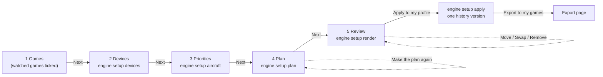

The Setup wizard sets up your controls for your games in one go. It looks at your connected devices, gives each one a
role (main stick, throttle, pedals, panel ...), makes relations for the important functions of your games' aircraft,
binds them to your devices and shows you the result as cheat sheets. You review everything before your profile
changes, and one **Undo** takes it all back. It runs without AI: the same choices always give the same plan.

Open it from the Start page (**Your games** > **Set up my devices automatically...**) or from the Binds page.

:::video setup-wizard "The Setup wizard, step by step"
:::

:::layer beginner
## The five steps

The steps are shown at the top; **Back** and **Next** at the bottom move between them. Close the window at any time:
a wizard you close before **Apply** comes back as you left it.

### 1. Games

The games you watch on the Start page are ticked. Tick the games this setup should cover. This does not change which
games JoyPro watches.

### 2. Devices

JoyPro recognises your sticks, throttles, pedals and panels and proposes a role for each one: "What this device is
for". Change a role in its list. **One device per hand**: a second stick for the same hand gets "unused" unless you
choose otherwise. A base that takes several grips asks for the grip. The box on the right says in words how JoyPro
will use them. **Detect again** reads the devices again (plug in a device first).

### 3. Priorities

- **Your aircraft**: search an aircraft ("F-16", "helicopter", "Star Citizen") and press **Add as next priority**
  (a new row) or **Add as equal** (into the selected row). The higher an aircraft, the better places its functions get.
  Aircraft in one row count the same; aircraft you do not list count least.
- **Modifiers**: a modifier is a button you hold (like Shift) so every other button does a second thing. Choose how
  many; **As few as possible** uses one only when your buttons run out.
- **Mode switch (phase layers)**: a latched switch can change what your buttons do per combat phase.
- **Like the real aircraft?**: left = group by function (the same button does the same thing in every aircraft); right
  = like the real aircraft's stick and throttle.

### 4. Plan

JoyPro makes the plan: how many functions it placed, what it could not place, the modifiers it made, the rules it
followed and a quality score per aircraft (100 % = every function on its best place).

### 5. Review

Pick a **Device** and an **Aircraft** to see JoyPro's drawing of the device with what is bound where. Select a function
in the list to move it to a free input, swap it with another one or take it out of the plan. **Not placed** lists what
did not fit, most important first.

When you like it: **Apply to my profile**, then **Export to my games** (the Export page opens). Your games change only
with the export.
:::

:::layer advanced
## Details

- **Roles**: main stick (right hand in every aircraft), heli stick (right hand in helicopters, for a second stick such as
  a force feedback base), left stick (left hand in space games; the throttle side without a throttle), throttle,
  collective (left hand in helicopters), pedals (rudder and toe brakes), panel (system switches whose printed label
  fits: "LDG GEAR UP" gets the gear), keyboard joystick and virtual (kept, nothing new bound), unused.
- **Your profile first**: a command that is already in one of your relations stays there, and a relation already bound
  on a device of this setup keeps its input. A command you switched off stays off.
- **Realism below 50 %**: one relation per function for all aircraft. **From 50 %**: aircraft whose real HOTAS has the
  function elsewhere get their own relation.
- The choices of step 3 are remembered; the next wizard starts with them.
- **Apply** writes everything as one change: one version in the profile History named "Setup wizard: N relations, M
  binds". **Undo** (Ctrl+Z) takes all of it back.
- **Open the sheet** shows the cheat sheet full size in your picture viewer, to print it.
- The new layout follows your most used aircraft of its class when Settings > Usage statistics > **Lay out new
  aircraft like my most used one** is on.
:::

:::ingame After Apply and an export
Nothing until you export. After **Apply** and an export, each game's control files hold the wizard's binds: in DCS
every chosen aircraft has the same function on the same button where you chose "group by function", Star Citizen gets
the ship controls on the stick and the strafe axes on a left stick, panels get the systems their labels name. Export
with **Replace on my devices** if the devices should lose the binds the game had before.
:::

:::layer technical
## Behind the wizard

Window `Views/SetupWizardWindow.axaml`, view model `ViewModels/SetupWizardViewModel.cs` (its own view model, created by
`MainWindowViewModel.SetupWizard.cs` with the watched games), planner `engine/SetupWizard/*.cs`. Every step is an
engine command, so the CLI makes the same plan: [[cli:setup devices]] (recognition and roles, `--role`, `--grip`),
[[cli:setup aircraft]] (the priority list), [[cli:setup plan]] (`--games`, `--priorities "A>B|C"`, `--modifiers`,
`--prefer-fewer` or `--use-all-modifiers`, `--realism`, `--phase-layers`, cockpit entries of [[cli:cockpits]] as
`--cockpit-file`; writes the plan JSON), [[cli:setup render]] (a callout sheet per device), [[cli:setup apply]]
(`--plan`, one profile version). Move, swap, remove and put back edit the plan in the GUI (`SetupPlanEdit`) and are
checked again before Apply. Reference: [[doc:setup-wizard|Setup wizard]].
:::

<!-- entry: bind:IsChosen -->
Step 1: tick the games this setup covers. The games you watch on the Start page (and started once) are ticked at the
start. Changing it here does not change which games JoyPro watches.

<!-- entry: DetectDevicesCommand -->
Step 2: reads your connected devices again and proposes a role for each one (plug a device in first). Roles you
chose stay chosen. Engine: [[cli:setup devices]].

<!-- entry: PriorityUpCommand -->
Step 3: moves the selected row of the priority list one place up (more important). You can also drag rows.

<!-- entry: PriorityDownCommand -->
Step 3: moves the selected row one place down (less important).

<!-- entry: RemovePriorityCommand -->
Step 3: takes the selected aircraft out of the priority list (or the whole row when no aircraft of it is selected).
An aircraft you do not list still gets functions; it counts least.

<!-- entry: bind:PreferFewer -->
Step 3, on by default: JoyPro adds a modifier only when your devices have too few buttons for the most important
functions, up to the number you chose, and tells you. Off: it uses every modifier you allowed. Engine:
`--prefer-fewer` / `--use-all-modifiers` of [[cli:setup plan]].

<!-- entry: MakePlanCommand -->
Step 4: makes the plan again with the current games, devices, priorities, modifiers and realism, for example after
going back and changing something. Edits made in the review are dropped. Engine: [[cli:setup plan]].

<!-- entry: MoveSelectedCommand -->
Step 5: moves the selected function (or a function of **Not placed**) to the free input picked in **Move to a free
input**. The sheet redraws. Only the plan changes; your profile changes with **Apply**.

<!-- entry: SwapSelectedCommand -->
Step 5: swaps the inputs of the selected function and the one picked in **Swap with** (buttons with buttons, axes with
axes). The sheet redraws.

<!-- entry: RemoveSelectedCommand -->
Step 5: takes the selected function out of the plan: **Apply** will not create or bind it. **Put back** undoes it.

<!-- entry: RestoreSelectedCommand -->
Step 5: puts a function you removed back into the plan, on its place.

<!-- entry: BackCommand -->
Goes to the previous step. Your choices stay; a changed choice makes a new plan at step 4.

<!-- entry: NextCommand -->
Goes to the next step and runs its engine command: detecting the devices (step 2, [[cli:setup devices]]), reading the
aircraft (step 3, [[cli:setup aircraft]]), making the plan (step 4, [[cli:setup plan]]) and drawing the sheets (step 5).
Refuses with a hint when no game is ticked or no device has a role.

<!-- entry: ExportCommand -->
After **Apply**: opens the Export page, where you export the games as usual. In the game: the wizard's binds arrive
with that export.

<!-- entry: click:CloseClicked -->
Closes the wizard window. Before **Apply** nothing has changed, and the wizard comes back as you left it the next time
you open it; after **Apply** the next one starts fresh.

<!-- entry: AddAsNewPriorityCommand -->
Step 3: puts the aircraft selected in the search results into a new row at the end of the priority list (below every
aircraft listed so far). A changed list makes a new plan at step 4.

<!-- entry: AddToSelectedPriorityCommand -->
Step 3: puts the selected aircraft into the selected row of the priority list, so it counts the same as the aircraft
already there (into the last row when no row is selected).

<!-- entry: MergeWithAboveCommand -->
Step 3: the aircraft of the selected row join the row above it, so they count the same as those aircraft. Does nothing
on the first row.

<!-- entry: SplitFromRowCommand -->
Step 3: takes the aircraft selected inside a row out of it and gives it a row of its own right below, so it counts a
little less than the others. Works only on a row with two or more aircraft.

<!-- entry: OpenSheetCommand -->
Step 5: opens the cheat sheet shown for the chosen device and aircraft full size in your picture viewer, to print it
and keep it next to the sim. The file is JoyPro's drawing from the review; nothing in your profile changes.

<!-- entry: ApplyCommand -->
Step 5: writes the plan's relations, binds and modifiers into your profile in one step: one version in the profile
History, and one **Undo** (Ctrl+Z) takes all of it back. The plan is checked first; a problem stops it with a hint.
Your games change only with the export (**Export to my games**). Engine: [[cli:setup apply]].
