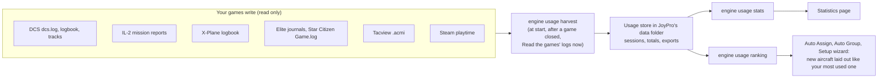

The Statistics page shows what you play and fly, across all your games: hours per game, your top 10 aircraft, ships
and vehicles, when you play, fun facts, what the games counted (landings, kills, jumps) and how your profile grew. The
numbers come from the games' own logs, journals, logbooks and replays and from Steam's playtime. Everything stays on
your PC.

The page is **off** by default: switch it on in Settings > **Usage statistics** > **Show the Statistics page in the
bottom bar**.

:::video statistics-page "The Statistics page"
:::

:::layer beginner
## What is on the page

- **Tiles** at the top: hours played in total (and how many of them your games logged themselves), sessions, the most
  played game, the longest streak.
- **Hours per game**: one bar per game, from the game's own log or Steam's playtime, whichever is higher.
- **Top 10 aircraft, ships and vehicles**: only games that log what you fly (DCS, IL-2, X-Plane, Falcon BMS, Elite
  Dangerous, Star Citizen, Tacview).
- **When you play**: hours per day of the week, sessions started per hour of the day, hours per month.
- **Fun facts**: "You flew the F-16C more than all helicopters together", your longest session, your first recorded
  flight, light years jumped. More facts come with more recorded sessions.
- **Counted in your games**: landings, kills, deaths, jumps and distance, where the game logs them.
- **Your profile**: binds per device, the oldest bind you have not used, how your relations and binds grew over the
  profile's history, exports per game.
- **Where the numbers come from**: each source and what it gave.

Nothing recorded yet? Play a game JoyPro supports: JoyPro reads its log when the game closes (and at the next start of
JoyPro). Steam's playtime counts as soon as Steam has some.
:::

:::layer advanced
## Details

- **Read the games' logs now** reads what the games wrote since the last time and redraws the page; normally this
  happens by itself at start and after a game closes.
- **Nothing counts twice**: a session read again (the log grew, moved into a backup folder, the live copy) replaces its
  record, the more complete read wins.
- Some games log nothing about the aircraft: MSFS keeps its logbook online (Steam's playtime only), War Thunder replays
  give the battle length but no vehicle. IL-2 writes mission reports only with `mission_text_log = 1` in its
  `data\startup.cfg`; JoyPro says so and never changes the game's files.
- The same numbers drive the ranking in Settings > **Usage statistics**: pin an aircraft there to make it the model
  for new aircraft of its class, or exclude one that should not count.
- Like every page, Statistics can be moved or hidden in Settings > **Pages in the bottom bar**.
:::

:::layer technical
## Behind the page

View model `StatisticsViewModel.cs` (its own view model; the main window passes the engine calls), view
`Views/StatisticsView.axaml`, charts `Views/Controls/UsageCharts.cs`; the harvest and ranking in
`MainWindowViewModel.Usage.cs`. Engine: [[cli:usage harvest]] reads new log data into `<data>\Usage`
(`sessions.jsonl`, `totals.json`, `seen.json`, `exports.jsonl`, `overrides.json`), [[cli:usage stats]] returns the
whole page as one JSON document (with `--profile` also binds per device, growth and the oldest unused bind),
[[cli:usage sources]] lists what exists on this PC. Every file is opened read-only and shared, so a game that writes
its log is never disturbed. Reference: [[doc:usage-statistics|Usage statistics]].
:::

<!-- entry: ReadNowCommand -->
Reads what your games logged since the last time (logs, journals, logbooks, replays, Steam's playtime) and redraws the
page. Normally JoyPro does this by itself at start and after a game closes. Engine: [[cli:usage harvest]], then
[[cli:usage stats]]. Changes nothing in your games or your profile.
