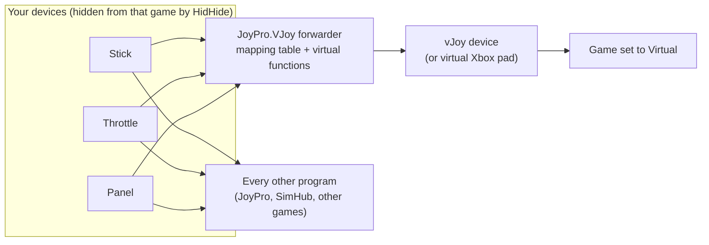
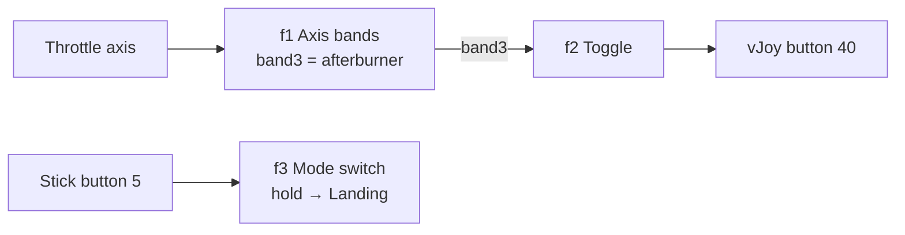
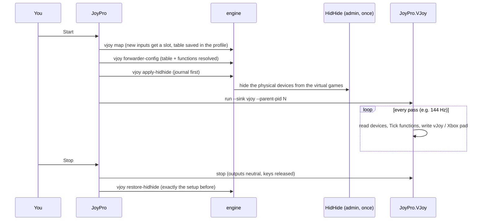

Some games take only a few joysticks, pick up the wrong ones or mix up their order when you plug in another device.
In virtual mode JoyPro puts every axis, button and hat that a game's binds use onto **one virtual joystick** (vJoy),
or onto a **virtual Xbox 360 pad** for games that only read gamepads. The game sees one device whose inputs never
move; your profile keeps your real devices. On top, **virtual functions** do what Joystick Gremlin does: axis bands
as buttons, toggles, short/long press, shift layers, macros, modes.

:::video vjoy-page "Virtual joystick: one device for picky games"
:::

:::layer beginner
## Use it in four steps

1. Under **Games** switch the game to **vJoy** (or **Xbox pad** for games that only take a gamepad). Games known to
   read only one device show a suggestion with **Use it**.
2. Export the game again on the [[gui:export|Export]] page. JoyPro writes the binds to the virtual joystick; your
   profile keeps your real devices.
3. Press **Start** before you start the game. JoyPro hides your real devices from that game with HidHide (Windows
   asks once for administrator rights) and copies every input to the virtual joystick live. Exception: the **Xbox
   pad** of Hell Let Loose: Vietnam and ACE COMBAT 8 reaches the game only when you start it once the game's title
   screen shows (or press **Stop** and **Start** there). The page says so under this step and in the tooltips of
   **Start** and of the auto start: for the game you set to Xbox pad, or naming both games while the list of games is
   not loaded yet.
4. Press **Stop** when you are done. HidHide gets back exactly the setup it had before; nothing stays hidden.

**What this page needs** shows the free drivers: vJoy (for games set to vJoy), ViGEmBus (Xbox pad) and HidHide. They
are not part of JoyPro; install the ones you need with one click there.

:::tip Test first
**Test** reads your devices and shows on the **Live test** tab what the game would get, without touching vJoy or
HidHide. Move your stick and watch the bars.
:::

:::ingame What changes in the game
The game's controls menu shows one device, "vJoy Device", with your binds on its buttons and axes. Your real devices
are invisible to that game only while the virtual joystick runs; every other program keeps seeing them. Curves, dead
zones and inverts still come from the game's own settings that JoyPro exports.
:::
:::

:::layer advanced
## The four tabs

**Overview**: what it is and how to use it; **Status** of vJoy (version, devices), HidHide and JoyPro's session
(**Refresh**, **Set up vJoy for the table** when a vJoy device lacks axes, buttons or hats, **Restore HidHide** after
a crash, **Set up vJoy for maximum**: 8 axes, 128 buttons, 4 hats, needs a Windows restart); **What this page needs**;
**Games** (Native / vJoy / Xbox pad per game, what the game reads of one joystick with warnings above it);
**Options**: hide the real devices (HidHide, recommended), start and stop by itself when a virtual game starts and
ends (JoyPro looks for it every 3 seconds; pressing Start before the game is still the safest for vJoy; the Xbox pad games above want it after their title screen).

**Mapping**: the table. Each physical input the virtual games use has a fixed place on the virtual joystick: an axis
keeps its own axis where it is free (X stays X), buttons and hats take the next free number. Existing places never
move, so the game's binds stay the same from run to run. **Update mapping** gives new inputs a place and saves the
table in the profile.

**Functions**: virtual functions, their modes, the Gremlin import and the graph (below).

**Live test**: bars for the axes, the pressed buttons and hats of each vJoy device as the forwarder writes them, with
the forwarder's log. **Show the virtual joystick live** switches the bars on or off.

## Virtual functions

Functions run inside the virtual joystick, between your devices and what the game gets. Pick the game, the type,
**Add function**, then set its inputs and outputs in the editor.

| Function | What it does |
|---|---|
| Axis bands | an axis split into up to 16 bands, each band a button (throttle detents) |
| Button cycle | each press steps to the next output |
| Toggle (latch) | a push button that stays on until pressed again |
| Switch to on/off pulses | a maintained switch sends one pulse per position |
| Short / long / double press | three jobs on one button |
| Shift layer | while the shift button is held, inputs go to other outputs |
| Merge / split axes | two pedals into one rudder; one axis into two |
| Axis curve | dead zone, saturation, curvature, invert, slider |
| Axis ends to buttons, axes to hat, buttons to axis, axis to encoder pulses | conversions |
| Turbo, macro | repeat while held; a sequence of presses and keys |
| Hat to buttons, buttons to hat, remap | hats and remaps |
| Mode switch | changes the mode (switch to, hold, toggle, cycle, back) |

The editor: name, **On**, **Keyboard output** (lets outputs and macro steps press keys; only while it runs for real),
a node view (inputs → function → outputs, lit while an output fires), the axis band bar with draggable edges, the
curve, **Works in modes**, **Mode to switch to**, inputs (device and input, **Clear**), outputs (vJoy button or
axis, Xbox control or key; **Bind relation** binds a relation to that output), settings and macro steps. **Try it**
runs the function in the editor with sliders and press buttons; nothing goes to vJoy or the game. **Save** stores it;
a running virtual joystick takes it after Stop and Start.

**Chaining**: an input can read another function's output instead of a device: pick `⚙ f1 ...` in the input's device
list, or drag in the **Graph of all functions** from an output dot (right edge) to an input dot (left edge). Loops are
refused. Click a wire, then its × to disconnect.

**Modes** (layers): give your inputs another job per situation (Combat, Landing ...). A mode can inherit from
another; a function works in the ticked modes (none = every mode). **Add mode**, **Rename**, **×** (remove),
**At start** (the mode the forwarder starts in). The running mode is marked live.

## Coming from Joystick Gremlin

Pick the game, optionally tick **Replace the game's functions and modes**, press **Import a Gremlin profile...** and
choose the `.xml` (R13 or R14). JoyPro shows a report first: what it makes of it, what it **cannot do** (activation
conditions, mouse actions, Python plugins, sounds ...) and what is **imported, but different**. Nothing is saved until
**Import**. Modes, remaps, curves, macros, merged axes, tempo, chain and toggle containers become functions and modes.
Then set the game to vJoy, keep or bind the relations on the vJoy outputs, export and **Start**: HidHide and the
forwarder replace Gremlin's device hiding and its background program.
:::

:::layer technical
## Behind the page

View models: `MainWindowViewModel.VirtualJoystick.cs` (status, table, Start/Test/Stop, auto start, live view),
`MainWindowViewModel.VirtualFunctions.cs`, `MainWindowViewModel.VirtualModes.cs` (modes, Gremlin import),
`VirtualFunctionEditorViewModel.cs`; views `VirtualJoystickView.axaml`, `VirtualFunctionEditorView.axaml`,
`Views/Controls/VirtualFunctionGraphView.cs`, `VirtualFunctionFlowView.cs`, `AxisBandEditor.cs`.

- **Mapping table**: in the profile (`Pr0file.VirtualJoystick`); [[cli:vjoy map]] (`--prune`, `--reset`),
  [[cli:vjoy mode]] (`native` | `virtual` | `xbox` per game), [[cli:vjoy status]], [[cli:vjoy settings]] (which vJoy
  devices JoyPro uses), [[cli:vjoy configure-vjoy]] (vJoyConfig, never takes anything away except avoided axes),
  [[cli:vjoy limits]].
- **Export, import, sync**: while a virtual game is exported, imported or synced, its binds point at the vJoy slots;
  afterwards the profile has its physical devices back. A missing vJoy device stops the export with a message.
- **HidHide session**: [[cli:vjoy apply-hidhide]], [[cli:vjoy restore-hidhide]], [[cli:vjoy recover]]: a journal is
  written before any change, so a crash can be restored (**Restore HidHide**).
- **Functions and modes**: [[cli:vjoy functions types]], [[cli:vjoy functions list]],
  [[cli:vjoy functions add --game]], [[cli:vjoy functions set --game]], [[cli:vjoy functions remove --game]],
  [[cli:vjoy functions test]] (simulate, nothing goes to vJoy), [[cli:vjoy modes list]]. Stored per game in the
  profile (`VJoySettings.Functions[game]`, `VJoySettings.Modes[game]`); their outputs are reserved in the table.
  The same evaluation code runs in the engine's test, the editor's preview and the forwarder; functions are evaluated
  in dependency order every pass, nothing is allocated per pass (about 10 µs per pass for 50 functions).
- **Gremlin**: [[cli:vjoy import-gremlin]] (`--dry-run` for the report, `--replace`, `--vjoy-device`).
- **Forwarder**: `gui/JoyPro.VJoy` (`JoyPro.VJoy.exe run --config ... --sink vjoy|dry`), non-exclusive DirectInput
  in, `vJoyInterface.dll` / ViGEmBus out. Test uses the dry sink and no HidHide.

Reference: [[doc:virtual-joystick]], drivers: [[doc:components]].
:::

<!-- entry: RemoveBandCommand -->
Axis bands editor: removes the last band (its edge goes away and the band before it grows). Save to keep it.

<!-- entry: bind:CurveInvert -->
Axis curve function: the output axis works the other way round.

<!-- entry: bind:CurveSlider -->
Axis curve function: treats the axis as one-sided (throttle, brake), without a centre and centre dead zone.

<!-- entry: RemoveCountCommand -->
One fewer of the numbered parts of the function: a cycle step, a shift layer input, a macro output (the + button adds
one).

<!-- entry: bind:IsChecked -->
A mode tick in the editor: under **Works in modes** the function works in that mode (none ticked = every mode); under
**Mode to switch to** the mode a mode switch goes to (Cycle goes through every ticked mode in order).

<!-- entry: ClearCommand -->
Clears this input row (device and input), so the function no longer reads anything there.

<!-- entry: label:Remove -->
In the function list: removes the function from the game (inputs of other functions that read it are cleared). In the
editor's macro steps: removes that step.

<!-- entry: AddStepCommand -->
Macro: adds a step (after n ms tap, press or release an output or key, hold n ms). Keys only with **Keyboard output**
on; they type only while the virtual joystick runs for real.

<!-- entry: label:Rename -->
Gives the mode the name typed in its box (`engine vjoy modes set --rename`). Functions that work in it keep it.

<!-- entry: AddVirtualModeCommand -->
Adds a mode with the typed name to the chosen game, inheriting from the mode picked next to it (`engine vjoy modes
add`). In the game: functions limited to that mode only work while it is the current mode.

<!-- entry: bind:GremlinReplace -->
For the Gremlin import: the game's existing functions and modes are replaced by the imported ones. Off: the imported
ones are added (`--replace`).

<!-- entry: click:ImportGremlinClicked -->
Picks a Joystick Gremlin profile (.xml, R13 or R14) and runs the import as a dry run (`engine vjoy import-gremlin
--dry-run`): the report shows the devices it found, the functions and modes it would make, what it cannot import
and what differs. Nothing is saved yet.

<!-- entry: label:Edit -->
Opens the function in the editor on the right (inputs, outputs, settings, modes, preview).

<!-- entry: label:On / off -->
Switches the function on or off. Off: the forwarder skips it, its outputs stay reserved.

<!-- entry: ConfirmGremlinImportCommand -->
Imports the reported Gremlin profile into the game (`engine vjoy import-gremlin`) and shows the graph of its
functions. Then bind the relations to the vJoy outputs (or keep them), export the game and press Start.

<!-- entry: CancelGremlinImportCommand -->
Closes the Gremlin report without importing anything.

<!-- entry: bind:VirtualJoystickLiveView -->
Live test tab: shows the virtual joystick's axes, buttons and hats live while Test or Start runs (on by default).
Off saves the redraws.

<!-- entry: bind:Enabled -->
Function editor: on by default. Off: the forwarder skips this function, but its virtual outputs stay reserved in the
table, so nothing else takes them. Saved with **Save**.

<!-- entry: bind:Keyboard -->
Function editor, off by default: lets this function's outputs and macro steps press keyboard keys (`KEY_...`). Keys
are sent only while the virtual joystick runs for real (**Start**), never in **Test** or **Try it**. Saved with
**Save**.

<!-- entry: bind:PreviewRunning -->
**Try it**: runs the function right in the editor with the inputs you set in the rows below (sliders, **Press**, hat
directions); the node view and the band bar light up as the outputs fire. Nothing goes to vJoy, the Xbox pad or the
game. While **Test** or **Start** runs on the page, the bars show your real devices instead (LIVE).

<!-- entry: AddBandCommand -->
Axis bands editor: splits the widest band in two, up to 16 bands; the new band gets an output of its own. Drag the
edges on the bar to place them. **Save** keeps it.

<!-- entry: AddCountCommand -->
One more of the function's numbered parts: a cycle step, a shift layer input, a macro output (the - button removes
one). The rows below grow at once; **Save** keeps it.

<!-- entry: bind:PreviewPressed -->
**Press** on a button input of the editor, for **Try it**: holds that button down until you click again, so you see
what the function does with it. Your real device is not involved.

<!-- entry: label:Bind relation -->
On an output that goes to vJoy: binds the relation named under **Bind a relation to an output** to this output, like
any vJoy button or axis ([[cli:binds set]]). Then export the game again so it gets the bind. Disabled for Xbox pad and
keyboard outputs.

<!-- entry: StartVirtualJoystickCommand -->
Updates the mapping table, hides your real devices from the games set to Virtual with HidHide (Windows asks once for
administrator rights; skipped when hiding is off) and copies their inputs to vJoy or the Xbox pad live. Press it
before you start the game. Exception: Hell Let Loose: Vietnam and ACE COMBAT 8 only see a virtual Xbox pad created
after their title screen shows, so press it there (or **Stop** and **Start** once the title screen shows); the tooltip
says so when one of them is set to Xbox pad. If the prompt is declined, nothing starts. Engine: [[cli:vjoy map]],
[[cli:vjoy forwarder-config]], [[cli:vjoy apply-hidhide]].

<!-- entry: TestVirtualJoystickCommand -->
Reads your devices and shows on the **Live test** tab what the virtual joystick would get. vJoy, the Xbox pad and
HidHide are not touched, so it also works without the drivers, and the profile is not changed: the mapping is only
checked (**Start** saves it in the profile). **Stop** ends it.

<!-- entry: StopVirtualJoystickCommand -->
Stops forwarding (the virtual joystick goes neutral, held keys are let go) and gives HidHide back exactly the setup it
had before. JoyPro does the same by itself when the forwarder ends on its own. Engine: [[cli:vjoy restore-hidhide]].

<!-- entry: RefreshVirtualJoystickCommand -->
Checks vJoy (version, devices), HidHide, JoyPro's session and the games again and updates the page. Read-only.
Engine: [[cli:vjoy status]].

<!-- entry: ConfigureVJoyCommand -->
Shown when a vJoy device lacks axes, buttons or hats the table needs: runs vJoyConfig once (Windows asks for
administrator rights) and adds what is missing. It never takes anything away from a device. Engine:
[[cli:vjoy configure-vjoy]].

<!-- entry: RestoreHidHideCommand -->
Shown while a HidHide session of JoyPro is open: gives HidHide back the setup it had before JoyPro changed it, for
example after JoyPro or the PC crashed (Windows asks for administrator rights). Engine: [[cli:vjoy restore-hidhide]].

<!-- entry: SetUpVJoyMaximumCommand -->
Asks first, then runs vJoyConfig once so each vJoy device JoyPro uses has 8 axes, 128 buttons and 4 hats (one
administrator prompt). Windows must restart before it takes effect; JoyPro never restarts Windows. Export the games in
virtual mode again afterwards. Engine: [[cli:vjoy configure-vjoy]] `--max`.

<!-- entry: RefreshComponentsCommand -->
**What this page needs** > **Check again**: looks again whether vJoy, ViGEmBus and HidHide are installed and running
and updates their cards. Read-only.

<!-- entry: ApplySuggestionCommand -->
**Use it** on a game known to read only one device: switches the game to the suggested mode (vJoy or Xbox pad). Export
the game again afterwards so its binds go to the virtual device.

<!-- entry: bind:VirtualJoystickHideDevices -->
On by default (recommended): **Start** hides your real devices from the games set to Virtual with HidHide, so they
see only the virtual device. Off: those games see your real devices and the virtual one, which can give double input.
Saved in the profile ([[cli:vjoy settings]]).

<!-- entry: bind:VirtualJoystickAutoStart -->
Off by default. On: JoyPro looks for a game set to Virtual every 3 seconds, starts the virtual joystick when the game
starts and stops it when the game ends. Pressing **Start** before the game is still the safest, as some games only
look for devices when they start. Not for the Xbox pad of Hell Let Loose: Vietnam and ACE COMBAT 8: the auto start
creates the pad within about 3 seconds of the game's start, before its title screen; if the game does not react to
the pad, press **Stop** and **Start** once the title screen shows. Saved in the profile ([[cli:vjoy settings]]).

<!-- entry: UpdateVirtualJoystickMappingCommand -->
**Mapping** tab: gives every new input the virtual games use a slot on the virtual joystick and saves the table in the
profile. Inputs that already have a slot never move, so the game's binds stay the same. Engine: [[cli:vjoy map]].

<!-- entry: AddVirtualFunctionCommand -->
Adds a function of the chosen type to the chosen game, with free virtual outputs, and opens it in the editor; then
choose its inputs there and press **Save**. Engine: [[cli:vjoy functions add --game]].

<!-- entry: label:× -->
On a mode: removes it after a question. Functions that worked only in it then work in every mode, mode switches lose
it as a target, and modes that inherited from it inherit from its parent. Engine: `engine vjoy modes remove`.

<!-- entry: label:At start -->
On a mode: the forwarder starts in this mode when the virtual joystick starts. The mode at start shows a label instead
of the button. Engine: `engine vjoy modes start`.

<!-- entry: bind:VirtualFunctionShowGraph -->
**Graph of all functions** / **Editor**: switches the right side between the graph of every function of the game
(drag from an output dot to an input dot to chain functions; loops are refused) and the editor of the function you
opened with **Edit**. Switching keeps unsaved edits in the editor.

<!-- entry: SaveVirtualFunctionCommand -->
Saves the function from the editor in the profile. A running virtual joystick takes it only after **Stop** and
**Start** (or **Test**); the message says so. Engine: [[cli:vjoy functions set --game]].

<!-- entry: CloseVirtualFunctionEditorCommand -->
Closes the editor without saving and shows the graph of all functions again. Unsaved changes are dropped.
