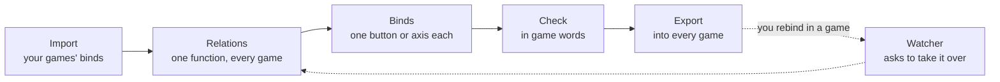

<h2>One profile for all your devices, in every flight and space game.</h2>

JoyPro puts the same function on the same button in every aircraft and every game: gear, flaps, countermeasures,
trim, throttle. Import what you already bound, let JoyPro fill the gaps, export back into each game's own settings.
Free and open source (GPL-3.0), no account, no telemetry.

<a class="btn" href="https://github.com/Holdi601/JoystickProfiler2/releases/latest">Download for Windows</a>
<a class="btn ghost" href="getting-started/first-steps.html">Your first profile in 10 minutes</a>
<a class="btn ghost" href="https://discord.gg/yK4gQA9xgk">Discord</a>

:::video intro "JoyPro 2 in three minutes"
:::

## How JoyPro thinks

- A **relation** is one function ("Gear Up/Down") with its action in every game and aircraft.
- A **bind** is the button or axis (and modifiers) the relation is on.
- **Export** writes it into each game's own control files, with a backup first and Undo.

## Start here

<a class="card" href="getting-started/install.html"><b>Download and install</b>Unzip, start, done. What it needs and where it keeps things.</a>
<a class="card" href="getting-started/first-start.html"><b>First start</b>JoyPro finds your games; link portable installs.</a>
<a class="card" href="getting-started/first-steps.html"><b>First profile in 10 minutes</b>Import, relations, binds, check, export, fly.</a>
<a class="card" href="faq.html"><b>Help and troubleshooting</b>The support file, the watcher, common questions.</a>

## The four main flows

<a class="card" href="flows/import.html"><b>Import a game</b>Take the binds you made in a game into a profile.</a>
<a class="card" href="flows/relations.html"><b>Build relations</b>Search, tick, add; suggestions, Auto Group, assistant.</a>
<a class="card" href="flows/export.html"><b>Export</b>The four modes and what each changes in the game.</a>
<a class="card" href="flows/check.html"><b>The Check</b>What would go wrong in the game, with one-click fixes.</a>

Every page is written in layers: **for beginners** (no PC knowledge needed), **advanced** (every option) and
**technical internals** (the engine commands and the code path). The switch at the top of a page shows one layer.

## Everything else

<a class="card" href="gui/start.html"><b>Every GUI page</b>{{stat:gui.controls}} controls, each with what it does and what runs behind it.</a>
<a class="card" href="games/index.html"><b>Games</b>{{stat:games.handled}} titles handled, {{stat:games.titles}} researched: a page per game with what JoyPro does there.</a>
<a class="card" href="cli/index.html"><b>Engine command line</b>{{stat:cli.commands}} commands, every option and value.</a>
<a class="card" href="project/jp1-vs-jp2.html"><b>From JoyPro 1 to 2</b>What improved, with the numbers.</a>

<b>{{stat:games.handled}}</b>game titles handled

<b>{{stat:languages}}</b>interface languages

<b>{{stat:cli.commands}}</b>engine commands

<b>{{stat:jp2.tests}}</b>automated tests

## Community and licence

- Ideas, questions, problems: the [JoyPro Discord](https://discord.gg/yK4gQA9xgk) or an issue on
  [GitHub](https://github.com/Holdi601/JoystickProfiler2/issues).
- JoyPro is free software under the GNU General Public License, version 3 or later. It comes with no warranty.
  JoyPro backs up every game file before it writes one; keep your own backups anyway.
- This site is generated from JoyPro's source code and documentation, so it describes the current version.
  [Wiki status](project/wiki-status.html) shows how complete it is.
