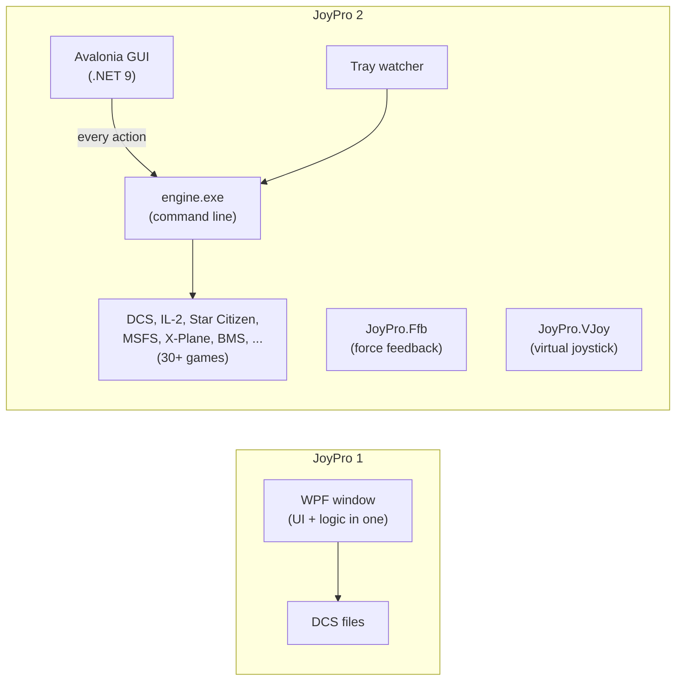

JoyPro 1 (2021 to 2023) was a DCS tool: it made relations between the inputs of different aircraft and bound them to
the same place on the stick. JoyPro 2 keeps exactly that idea and the same relation / bind / modifier model (a JoyPro 1
profile opens in JoyPro 2), and rebuilds everything around it: a new interface, an engine that also runs on its own,
dozens of games, tests for every feature, and a lot of safety.

:::video jp1-to-jp2 "Coming from JoyPro 1"
:::

## The numbers

All numbers are measured on the source of both projects (files tracked in git; code lines = non-empty C# lines that
are not comments). JoyPro 2's numbers are from the build of this site.

| | JoyPro 1 | JoyPro 2 |
|---|---|---|
| Development | {{stat:jp1.first}} to {{stat:jp1.last}} | since {{stat:jp2.first}} |
| Commits | {{stat:jp1.commits}} | {{stat:jp2.commits}} |
| C# code lines | {{stat:jp1.cs.code}} | {{stat:jp2.cs.code}} ({{stat:ratio.cs}} x) |
| C# files | {{stat:jp1.cs.files}} | {{stat:jp2.cs.files}} |
| Types (classes, records, enums ...) | {{stat:jp1.types}} | {{stat:jp2.types}} ({{stat:ratio.types}} x) |
| Methods | {{stat:jp1.methods}} | {{stat:jp2.methods}} ({{stat:ratio.methods}} x) |
| Automated tests (unit, view model, render) | {{stat:jp1.tests}} | {{stat:jp2.tests}} in {{stat:jp2.testfiles}} test files |
| Engine smoke test parts (real engine on fixture folders) | 0 | {{stat:smoke.parts}} |
| Projects in the solution | {{stat:jp1.projects}} | {{stat:jp2.projects}} |
| Interface markup lines | {{stat:jp1.xaml.lines}} (WPF XAML) | {{stat:jp2.axaml.lines}} (Avalonia AXAML) |
| Documentation lines (Markdown) | {{stat:jp1.md.lines}} | {{stat:jp2.md.lines}} |
| Games | 1 (DCS), later IL-2 | {{stat:games.handled}} handled by JoyPro, {{stat:games.titles}} titles researched |
| Interface languages | 1 | {{stat:languages}} |
| Engine commands (command line) | none (GUI only) | {{stat:cli.commands}} in {{stat:cli.areas}} areas, {{stat:cli.globals}} global options |
| GUI controls documented on this site | | {{stat:gui.controls}} |

Where the code lives in JoyPro 2 (C# code lines): engine {{stat:jp2.engine.code}}, GUI {{stat:jp2.gui.code}}, GUI
tests {{stat:jp2.guitests.code}}, force feedback {{stat:jp2.ffb.code}}.

:::layer beginner
## What is better for you

- **Many games, one profile.** JoyPro 1 was for DCS. JoyPro 2 imports and exports {{stat:games.handled}} game titles:
  DCS, IL-2 (Great Battles, Korea, 1946, Cliffs of Dover), Star Citizen, MSFS 2020 and 2024, X-Plane 11 and 12, Falcon
  BMS, War Thunder, Elite Dangerous, X4, Arma, and more. One relation holds the same function in all of them.
- **Start from what you have.** Import reads your existing binds from each game; the first-start setup finds your
  games by itself.
- **Nothing can break for good.** Every export backs up the game files first, and **Undo last export** puts them back
  byte for byte. Every change in JoyPro is saved automatically and can be undone, even after a restart (profile
  history).
- **It tells you what would go wrong.** The Check explains problems in game words and fixes them with one click.
- **Less clicking.** Suggestions, Auto Group, Auto Assign, the setup wizard and a JoyPro assistant build relations and
  binds for you; a learned "your style" follows how you did it before.
- **It notices changes.** When you rebind something inside a game, JoyPro asks after the game closes whether to take
  it into your profile.
- **Your language.** The interface speaks {{stat:languages}} languages.
- **More than binds.** Device pictures and cheat sheets, a HUD and stream overlay, force feedback from telemetry, a
  virtual joystick for games that read only one device, a cockpit database, statistics of what you fly.
- **No extra runtimes to hunt.** The release is one zip with everything inside; no SlimDX, no C++ runtimes.
:::

:::layer advanced
## Feature by feature

| Area | JoyPro 1 | JoyPro 2 |
|---|---|---|
| Relations | by hand, DCS ids | by hand with search over every game, synonyms, the function catalog, suggestions with reasons, Auto Group, group by description, assistant; "same id, different meaning" per DCS aircraft |
| Binds | record a button or axis | record, follow input, bind on the device picture, Auto Assign for any device combination, setup wizard, Lay out with AI |
| Axis tuning | DCS curvature, dead zone, saturation | per game in its own response model, scopes per aircraft, calibration, detent mode |
| Modifiers | yes | yes, with a modifier page, combinations, per-game translation (BMS shift, ...) |
| Export | DCS (clean, nuke) | every game; four modes plus "also clear", per-aircraft, minimal diff to DCS's defaults, marks for binds not written, backups and undo |
| Import | DCS | every game, with defaults, keyboard, device merge, re-import of names/groups/modifiers |
| Safety | "make a backup yourself" | automatic versioned backups, refuses to write while a game runs, profile history with undo across sessions, write sandbox in tests |
| Checks | validate | the Check: cards in game words, one-click fixes, caused-by from the history |
| Layouts | export layout pictures | device reference pictures (exact model by VID:PID and HID name), cheat sheets, 3D device views |
| Overlay | in-game overlay | HUD designer, overlay, stream page for OBS, live inputs |
| Games list | shipped database (html) | built on your PC from your own installation, refreshed after game updates |
| Watching | none | game config watcher with tray host, asks after the game exits |
| Force feedback | none | telemetry force feedback for DCS, IL-2, War Thunder and more (JoyPro.Ffb) |
| Virtual devices | none | vJoy / Xbox pad mode with HidHide, virtual functions, Joystick Gremlin import |
| Languages | English | {{stat:languages}} |
| Updates | download by hand | update check with release notes, checksum-verified install |
| Problem reports | ask on Discord | one support file with logs, settings and (on request) the profile; user folder replaced; nothing uploaded |
:::

:::layer technical
## Architecture and quality

- **Split into engine and GUI.** JoyPro 1 was one WPF application with the logic in the window code. JoyPro 2 has an
  engine (`engine.exe`, .NET Framework 4.8, plain C#) that holds all profile, import/export and database logic as
  {{stat:cli.commands}} commands, and an Avalonia GUI (.NET 9) that runs the engine for every action. Quick
  interactive commands go to one long-running `engine serve`, so the GUI stays fast without giving up the separation.
  Everything the GUI does can be scripted (see [[page:cli/index.html|the engine command line]]).
- **Separate processes for permanent jobs**: `JoyPro.Ffb.exe` (telemetry force feedback), `JoyPro.VJoy.exe` (the
  virtual joystick forwarder), `JoyPro.Tray.exe` (the watcher while the GUI is closed), each with resource budgets
  and soak tests so they stay unnoticeable in the background.
- **Tests**: {{stat:jp2.tests}} automated tests (xUnit: engine logic, view models, offscreen renders of pages in light
  and dark), {{stat:smoke.parts}} engine smoke test parts that run the real engine against fixture folders, an opt-in
  quality gate with invariant checks on real data, and in-game end-to-end runs for the games that support them. Tests
  run in a write sandbox with a real-folder fingerprint check, so no test can touch real game folders.
- **Data**: game command lists are built on the user's PC from the installed game into `%LOCALAPPDATA%\JoyPro2\GameData`;
  JoyPro ships only its own data (function catalog, device catalog, conversion tables, cockpit database).
- **Docs generated from the source**: the game support matrix comes from the code (`engine games support`), the CLI
  reference from `engine --help`, and this site from the AXAML, the view models and the docs.
:::

## Related

- [[page:project/wiki-status.html|Wiki status]]: how complete this documentation is
- [[game:support|Game support]]: every game with what JoyPro does for it
